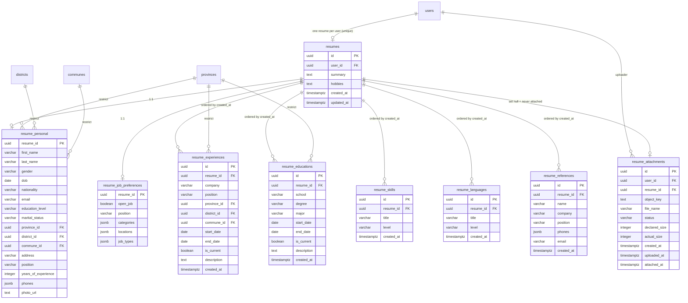

# Resume (CV) persistence — the database-backed resume

## Context

The Resume (CV) builder at `/me/resume` is finished as a UI but has no storage
of any kind: refresh loses everything. The captain's ask is to integrate it with
the database end to end — "make plan and table, and how you going to make it
work". This is the persistence half of `tasks/plan-resume-data-display.md` §5,
which already settled the direction (one table per section, `GET /resume`
assembled for the own user, per-entry writes, the CV file going to Storage).

The resume UI exists **only in the working tree** — it is uncommitted code under
`apps/web/components/profile/`. It must be extended, never re-created.

The captain answered the three open questions on 2026-10-15: an abandoned wizard
lands on the preview, the CV upload ships (private bucket, mirroring the chat
attachments pattern), and a resume is never publicly readable. Those answers are
folded into the body below and recorded in `## Revision R1` and
`## Revision R2` at the end.

## Current state

- **State ownership.** `apps/web/components/profile/ResumeStartBuilding.tsx` owns
  the whole document as React state (`:85-95`: `personal`, `summary`, `hobbies`,
  `experiences`, `educations`, `skills`, `languages`, `references`,
  `jobPreference`). Entries are upserted by id (`:59-62`), deleted by a state
  filter (`:138-146`), and the wizard finishes by flipping `done` (`:97-103`).
  There is **no fetch, no server action, no localStorage** anywhere in the
  resume components — verified by reading all 13 files.
- **Page.** `apps/web/app/[locale]/(user)/me/resume/page.tsx` renders `Resume`
  (`components/profile/Resume.tsx`), which is an async RSC: it resolves
  `getCurrentUser()` + the Jobs subcategory list + the `jobtypes` attribute rows
  - provinces (`Resume.tsx:41-54`) and passes down only
    `firstName`/`lastName`/`preferenceOptions` (`:68-76`).
- **Dialogs.** Each of the 9 dialogs holds its own local state and reports one
  entry upward on its valid action (`onSubmit` / `onDataChange`). The personal
  dialog is the odd one: it pushes on **every keystroke** through a `useEffect`
  (`ResumePersonalDetailsDialog.tsx:234-267`), and its photo is a FileReader
  data URL (`:162-172`) — never uploaded, with only an `accept="image/*"` on the
  input (no type or size check).
- **Validation today is client-only.** `resume-validation.ts:10-28` (email,
  phone, years-of-experience), `ResumeEducationsDialog.tsx:117-125` /
  `ResumeExperiencesDialog.tsx:121-131` (date order), `ResumeReferencesDialog.tsx:105-125`.
  Phone inputs accept the local `0XXXXXXXXX` shape with spaces/dashes
  (`resume-validation.ts:17-20`), which the backend's `AddPhoneDto`
  (`^\+?[1-9]\d{6,14}$`, `add-phone.dto.ts:6`) would reject.
- **The finished view** (`ResumePreview.tsx`) is a pure render of the passed doc:
  photo through raw `next/image` (`:554`) rather than `DbImage`; the CV card's
  "Upload file (CV)" (`:928-934`) and the header's "Download resume" (`:522-528`)
  have **no onClick at all**; the Attachment chip is hardcoded `filled: false`
  (`:388`), so the completed-% can never reach 100.
- **Backend has nothing.** `grep -ri resume apps/backend/src` returns zero hits:
  no module, no schema, no route, no migration.
- **Module templates.** `apps/backend/src/reactions/` is the closest-sized
  precedent for the CRUD module; `apps/backend/src/chat/`'s attachment stack
  (`chat-attachments.service.ts`, `chat-attachments.controller.ts`,
  `chat-attachments.constants.ts`, `dto/attachments.dto.ts`,
  `chat-maintenance.processor.ts`) is the precedent for the CV file — a private
  bucket, signed upload, verified size, signed download, orphan cleanup. Mirror
  it; do not invent a second mechanism. On the web the same handshake already
  exists twice: `components/post/ImageUpload.tsx:42-57` (sign → PUT bytes →
  persist `{url, path}`) and `lib/e2e/attachments/uploader.ts:30-60`
  (`directUploader`: create → PUT → complete, idempotent under retry). Follow
  those recipes; do not write a third one.
- **Schema conventions.** Schema files live in `src/db/schema/*.schema.ts` and
  are re-exported from `index.ts` (`:1-14`); `casing: 'snake_case'` is set in
  `drizzle.config.ts` so columns are written camelCase. Child tables with
  `onDelete: 'cascade'` into `users` are required because `AccountPurgeService`
  hard-deletes the user row and relies on cascades
  (`account-purge.service.ts:38`).
- **Config.** Buckets are per-concern env vars wired in `configuration.ts`
  (`chat: { filesBucket: env.CHAT_FILES_BUCKET, … }`, `:20-23`) and Zod-validated
  in `config.validation.ts` (`CHAT_FILES_BUCKET` + the dashboard setup note,
  `:14-17`). `SupabaseService` already exposes everything the CV needs:
  `createSignedUploadUrl`, `objectInfo`, `createSignedUrl(s)`, `removeObjects`
  (`supabase.service.ts:90-160`).
- **Migrations.** `drizzle/migrations/meta/_journal.json` ends at entry `idx: 34`
  (`0034_acoustic_chat`, `when: 1790742092643`); snapshots are named by index
  (`meta/0035_snapshot.json`), the `.sql` is looked up by the journal `tag`.
- **Uploads (photos).** `POST /files/sign` allowlists 9 scopes
  (`files.controller.ts:18-38`) — no resume scope; the web's `UploadScope`
  mirrors it (`actions/files.ts:10-19`). The web's delete helper `deleteUploaded`
  (`actions/files.ts:90-106`) uses the **admin** session, so it cannot be reused
  by a user-facing surface as-is.
- **Idempotency is a non-issue for these routes**: the middleware returns
  immediately when no `Idempotency-Key` header is sent
  (`idempotency.middleware.ts:33-38`), and the web actions send none.

## Goal

1. A resume is stored in Postgres and comes back after a refresh, on any device.
   Every dialog's valid Save/Next writes the one thing it edited; the preview and
   the wizard both read/write the same persisted document.
2. `GET /api/v1/resume` returns the whole document assembled for the caller, in
   the exact shape the UI already renders, including its CV attachment.
3. The resume photo is uploaded to Supabase Storage (new `resume` scope) after a
   client-side image type/size check, instead of living as a data URL, and it
   survives a refresh like everything else.
4. The CV file uploads to a **private** bucket with the chat-attachment
   lifecycle (signed upload → size verified from storage → attached),
   "Download resume" reads it back through a short-lived signed URL, and the card
   can replace or remove it.

## Non-goals

- **No PDF export, no print view and no server-side rendering of the CV
  document** ("Download resume" downloads the user's uploaded CV file, never a
  generated one). A PDF library is a new dependency, which is banned.
- **No parsing of the uploaded CV** — the file replaces the stored CV; it never
  rewrites the resume sections. The card's "You'll get to review everything
  before it's saved" copy is aspirational and stays unbuilt (see Known gaps).
- No public or cross-user read of a resume, ever — see Decision 13. Recruiter
  visibility arrives with job applications, not by loosening `GET /resume`.
- No resume delete/reset endpoint (no UI asks for one; removing the CV _file_ is
  the attachment's own route, not a resume delete).
- No change to the wizard's steps, copy, layout, or validation rules; no change
  to the preview's layout. Save-timing and upload wiring only.
- No new dependencies, no `@repo/*` imports, no touch of payment/outbox/chat's
  own code (the chat _pattern_ is copied, not its tables or its E2E layer).
- No `src/resume/README.md`. The Module README convention triggers on an explicit
  request ("give me the README for `<module>`"); nothing in this ship asks for
  one. Recorded so the file is not invented.

## Decisions

1. **Relational tables, one per repeating section** (9 tables, below) rather than
   one `resumes` row with JSONB arrays. The repo stores repeating, typed,
   addressable rows as child tables (`user_phones`, `listing_photos`,
   `user_auth_providers`) and reserves JSONB for genuinely open-ended data
   (`attributes`, `field_schema`, `imagePaths`). Resume sections have fixed,
   known columns; JSONB would discard that and make every save a whole-document
   read-modify-write, which AGENTS.md warns against. The two free-text sections
   (`summary`, `hobbies`) are plain columns on the parent because their only
   "presence" test in the UI is a non-empty string. **Trade-off:** 9 tables and a
   longer service; the alternative (single JSONB document) is a fraction of the
   code but gives up per-entry ids and per-row writes. Evolution path: a section
   that needs richer behaviour later already has its own table.
2. **One resume per user**, enforced by `UNIQUE(user_id)`. The UI has exactly one
   "Create a New Resume(CV)" card and no picker. Evolution path: drop the unique,
   add `title` + `is_default` when multi-resume is actually requested.
3. **Save timing: write-through per submit point, awaited before the dialog
   advances or closes.** The captain's plan (§4.4) already decided "each form's
   Save writes immediately … no separate page-level Save". Rejected alternatives:
   (a) leaving the dialogs untouched and firing the save in the background — a
   failed save then leaves the UI ahead of the DB, so the finished preview can
   show rows that were never stored; (b) one page-level Save button — explicitly
   rejected in the plan.
4. **`done` flips on the first successful save; the wizard is reachable only
   while nothing is saved.** `ResumeStartBuilding` starts `done = initial !== null`
   and sets it `true` after any successful write, so the start card and the
   wizard exist only in the "nothing persisted yet" state. The captain's exact
   walk — Step 1 → "Next to summary" (Step 1 saved) → Back → X — must therefore
   reopen on the **preview** with the saved personal details, every missing
   section reading "+ Add X" and the chips/% derived from stored data; never the
   start card, never a blank Step 1. Losing typed-but-unsaved work on Back → X is
   acceptable **only** for steps that were never submitted (an unsaved Step 3 is
   gone; a saved Step 1 is not). Without this rule, closing the wizard mid-way
   would return to the start card and reopening "Start building" would show a
   blank Step 1 over data that is already stored, inviting an overwrite. This is
   the captain's answer to Q1, so there is no `wizard_step` column and no
   wizard-resume path.
5. **Personal details are the resume's own copy, not a read-through to `users`.**
   A CV is a document: it is prefilled from the account (`defaultFirstName` /
   `defaultLastName`, `Resume.tsx:69-70`) but must be allowed to differ, and
   editing the CV must not silently rename the account. `resume_personal` also
   holds fields the account has no column for (nationality, education level,
   marital status, current position, years of experience).
   **Trade-off:** the same human's name/phone/location exists twice; the account
   remains the authority for the navbar and profile, the resume for the CV.
6. **Client-generated entry ids, upserted server-side** (`PUT
/resume/<section>/:id`), instead of POST-creates that return a server id. The
   dialogs mint `crypto.randomUUID()` once per draft
   (`ResumeEducationsDialog.tsx:83`) and re-submit the same draft when the wizard
   goes Back → Next; an id-keyed upsert is idempotent by construction, while a
   POST-only create would insert a second row and force an id-remapping dance in
   the client. Ownership is enforced by scoping the conflict update to the
   caller's own resume (`resume_id = <caller>`) and returning 404 when no row
   was written — a foreign id can never be overwritten and never leaks existence.
7. **The photo is in scope, and it is validated before it leaves the browser.**
   Upload on pick (sign → PUT → public URL, the `ImageUpload.tsx:42-57` recipe),
   store the URL on `resume_personal.photo_url`, render through `DbImage` (the
   repo's rule for every DB image), clean up the replaced object after the write
   commits, and delete an object that was uploaded but never saved when the
   dialog closes. The picker gains the checks the FileReader path never had:
   `file.type.startsWith('image/')` and ≤ 5 MB, toasted on rejection — the
   captain's "must accept image" is a bound in both directions: an image is
   accepted, and a non-image is refused (see R2). No data URLs survive this
   ship.
8. **The CV file mirrors the chat attachment stack, in its own private bucket.**
   `resume-files` (public off, 5 MB object limit, allowed types pdf/doc/docx/txt)
   — a CV is personal data, so it is never a public URL and never touches the
   `listings` bucket. Lifecycle: `POST /resume/attachments` reserves the object
   and returns a signed upload URL → the browser PUTs the bytes straight to
   storage → `POST /resume/attachments/:id/complete` reads the **actual size back
   from storage** (`SupabaseService.objectInfo`, the chat `complete` pattern) and
   either attaches it or removes the object and marks the row `expired`. A
   replaced CV has its object and row removed after the attach transaction
   commits; `DELETE /resume/attachments` is the same removal path exposed for the
   owner. Download is a 5-minute signed URL for the owner only.
   **What is enforced and what is not:** the size is enforced three times over
   (the client pre-check, the cap in the DTO and the constants, and the storage
   read-back on `complete`) — but the _file type_ can only ever be advisory,
   because on a signed upload the bytes never pass through the backend: the
   extension check is client-side and the bucket's `allowed_mime_types` sees only
   the `Content-Type` the browser claims. That is stated plainly under Known gaps
   rather than dressed up as server-side validation. A CV is plaintext in that
   private bucket (there is no E2E layer, unlike chat); the bucket's privacy plus
   the short-lived signed URL are the whole protection.
   **The card owns the whole lifecycle — upload, replace, remove.** The filled
   row carries a remove control wired to `DELETE /resume/attachments` (Decision
   8's own route, otherwise unreachable from the UI): it clears the attachment
   state, un-fills the chip and takes "Download resume" away with it. Without it
   a CV uploaded by mistake could only ever be replaced by a second file — see
   R2.
   **"Download resume"** returns that uploaded file and nothing else: rendered
   only when an attachment exists (hidden, never inert — no dead control) and it
   never generates a PDF (banned dependency).
9. **Blank optional strings are normalized to `null` by the web actions** before
   the request. The backend DTOs use `@IsOptional()`, which skips validation for
   `null`/`undefined` but **not** for `""` — so `""` would 400 against
   `@IsEmail()` / `@IsUUID()`. Required-but-empty is the dialog's job (it already
   refuses to submit).
10. **Validation parity is split by kind**: shape in the DTO (types, lengths,
    formats, array caps), relations in the service (end-date ≥ start-date,
    `current` implies no end date, a district/commune without its parent, and the
    years-of-experience range backstop). Cross-field rules cannot be expressed
    with class-validator decorators alone, and the service is where the repo's
    unit tests already point. File **size** is enforced at three points — the
    client pre-check, the DTO/constant cap, and the storage read-back on
    `complete`; the file **type** is advisory only (Decision 8).
11. **Location values are stored as ids** (`provinces`/`districts`/`communes`
    FKs, `ON DELETE RESTRICT` like `users`, so a geography re-seed can never
    silently blank a CV) and resolved for the response by a **batch lookup**
    (`inArray` on the collected ids → `Map`), not by aliased joins. That is the
    repo's documented "batch-lookup pattern" (`CLAUDE.md`, admin pages) and it
    avoids six aliased joins across two entry queries.
12. **A failed load is visible, never silent.** `GET /resume` failing must not
    render an empty builder — starting the wizard from that state would overwrite
    real data. The page renders an error card instead.
13. **A resume is only ever its owner's.** There is no public `GET /resume`, and
    there never will be one keyed on the resume id or the owner's username.
    Recruiters see a resume **only** inside a job application the owner
    deliberately submitted: when that feature is built it gets an
    application-scoped read with its own allow-list, and `GET /resume` stays
    owner-only. This is a forward constraint on the next resume-shaped ask, not
    work in this ship (the application feature does not exist yet — the
    `/me/applied-jobs` and `/me/job-applications` pages are still mock).

## Implementation plan

### 1. Data model — NEW `apps/backend/src/db/schema/resume.schema.ts`

Add `export * from './resume.schema';` to `apps/backend/src/db/schema/index.ts`.
Follow `reactions.schema.ts` / `notifications.schema.ts` for style (doc comment
per table, `check(...)` from `drizzle-orm/pg-core`, `jsonb(...).$type<string[]>()`).

`resumes` — the document and the ownership anchor.

- `id` uuid PK default random
- `user_id` uuid not null, **unique index** `resumes_user_id_uq`, FK `users.id` cascade
- `summary` text not null default `''`
- `hobbies` text not null default `''`
- `created_at` / `updated_at` timestamptz not null default now() (`$onUpdate`)

`resume_personal` — 1:1 Step-1 block; `resume_id` is the **primary key** (a
second personal row is impossible by construction).

- `resume_id` uuid PK, FK `resumes.id` cascade
- `first_name` varchar(50) not null, `last_name` varchar(50) not null
- `gender` varchar(20), `dob` date, `nationality` varchar(50),
  `email` varchar(254), `education_level` varchar(40), `marital_status` varchar(20)
- `province_id` / `district_id` / `commune_id` uuid, FK `provinces` / `districts` /
  `communes`, `onDelete: 'restrict'`
- `address` varchar(200), `position` varchar(100), `years_of_experience` integer
- `phones` jsonb not null default `[]` (`$type<string[]>()`)
- `photo_url` text
- `updated_at` timestamptz not null default now() (`$onUpdate`)
- `check('resume_personal_years_range', sql\`years_of_experience is null or years_of_experience between 0 and 60\`)`
- `check('resume_personal_phones_max', sql\`jsonb_array_length(phones) <= 3\`)`

`resume_experiences` — `id` uuid PK; `resume_id` uuid not null FK cascade +
`index('resume_experiences_resume_id_idx')`; `company` varchar(100) not null;
`position` varchar(100) not null; `province_id`/`district_id`/`commune_id` (as
above, restrict); `start_date` date not null; `end_date` date; `is_current`
boolean not null default false; `description` text not null default `''`;
`created_at` timestamptz not null default now().
Checks: `end_date is null or end_date >= start_date`, and
`not is_current or end_date is null`.

`resume_educations` — identical shape with `school` varchar(100) not null,
`degree` varchar(40) not null, `major` varchar(100) not null instead of
company/position. Same two checks, same index.

`resume_skills` — `id` uuid PK; `resume_id` (FK cascade + index);
`title` varchar(50) not null; `level` varchar(20) not null; `created_at`.

`resume_languages` — identical to `resume_skills`.

`resume_references` — `id` uuid PK; `resume_id` (FK cascade + index);
`name` varchar(50) not null; `company` varchar(100) not null;
`position` varchar(100) not null; `phones` jsonb not null default `[]` +
`check(... jsonb_array_length(phones) <= 3)`; `email` varchar(254);
`created_at`.

`resume_job_preferences` — 1:1, `resume_id` uuid PK FK cascade;
`open_job` boolean not null default false; `position` varchar(100);
`categories` jsonb not null default `[]`; `locations` jsonb not null default
`[]`; `job_types` jsonb not null default `[]`; `created_at` / `updated_at`.

`resume_attachments` — the CV file, mirroring `chat.attachments` column for
column (`chat.schema.ts:449-486`):

- `id` uuid **PK, client-generated** (a retried create returns the same row)
- `user_id` uuid not null FK `users.id` cascade (the owner)
- `resume_id` uuid FK `resumes.id` **on delete set null** — `null` means "never
  attached", which is exactly what the orphan job sweeps (same reasoning as
  `chat.attachments.message_id`)
- `object_key` text not null — server-generated `{userId}/{id}/{safeFileName}`
  (the trailing name is what the browser saves the download as)
- `file_name` varchar(255) not null — the display name
- `status` varchar(20) not null default `'pending'` — `pending | attached | expired`
- `declared_size` integer not null (client claim, for the early check only)
- `actual_size` integer (read from storage on complete — the only trusted size)
- `created_at` / `uploaded_at` / `attached_at` timestamptz
- indexes: `resume_attachments_resume_idx` on `(resume_id)`,
  `resume_attachments_orphan_idx` on `(created_at)` where `resume_id is null`,
  `resume_attachments_user_created_idx` on `(user_id, created_at)`

The table is 1:1 with `resumes` **in steady state** without being a 1:1 primary
key: at most one attached row per resume is ever live, because `complete`
attaches and removes the predecessor in one transaction (below) — but a `pending`
row exists before the CV does and carries no `resume_id`, which is what lets the
orphan sweep find it. `resume_personal`'s PK-as-FK trick is not available here
for exactly that reason.

Ordering: every child read is `ORDER BY created_at ASC, id ASC` — insertion order
is the display order for skills/languages/references, and the two dated sections
are sorted client-side by start date (`ResumePreview.tsx:150-151`). The `id`
tie-break keeps the order deterministic if two rows ever share a timestamp. No
`sort` column ships (nothing in the UI reorders rows by hand).



### 2. API surface

All routes are JWT (no `@Public()`), hang off `@Controller('resume')`, and take
`@CurrentUser() user: RequestUser`. `:id` is `ParseUUIDPipe`. The response
envelope is automatic.

| Method | Path                               | Body                                                          | Returns                                         |
| ------ | ---------------------------------- | ------------------------------------------------------------- | ----------------------------------------------- |
| GET    | `/resume`                          | —                                                             | `ResumeDocumentWire`                            |
| PUT    | `/resume/personal`                 | `UpdatePersonalDto`                                           | `ResumePersonalWire`                            |
| PATCH  | `/resume`                          | `UpdateResumeDto` (`summary?`, `hobbies?`, `jobPreferences?`) | `{ summary, hobbies, jobPreference }`           |
| PUT    | `/resume/experiences/:id`          | `UpsertExperienceDto`                                         | `ResumeExperienceWire`                          |
| DELETE | `/resume/experiences/:id`          | —                                                             | `{ id, deleted: true }`                         |
| PUT    | `/resume/educations/:id`           | `UpsertEducationDto`                                          | `ResumeEducationWire`                           |
| DELETE | `/resume/educations/:id`           | —                                                             | `{ id, deleted: true }`                         |
| PUT    | `/resume/skills/:id`               | `UpsertSkillDto`                                              | `ResumeSkillWire`                               |
| DELETE | `/resume/skills/:id`               | —                                                             | `{ id, deleted: true }`                         |
| PUT    | `/resume/languages/:id`            | `UpsertLanguageDto`                                           | `ResumeLanguageWire`                            |
| DELETE | `/resume/languages/:id`            | —                                                             | `{ id, deleted: true }`                         |
| PUT    | `/resume/references/:id`           | `UpsertReferenceDto`                                          | `ResumeReferenceWire`                           |
| DELETE | `/resume/references/:id`           | —                                                             | `{ id, deleted: true }`                         |
| POST   | `/resume/attachments`              | `CreateResumeAttachmentDto`                                   | `{ id, uploadUrl, token, expiresIn }`           |
| POST   | `/resume/attachments/:id/complete` | —                                                             | `{ id, status: 'attached', size }`              |
| POST   | `/resume/attachments/sign`         | —                                                             | `{ url, expiresAt }` or `[]` when there is none |
| DELETE | `/resume/attachments`              | —                                                             | `{ deleted: true }`                             |

17 routes on one thin controller — one writer per dialog, one reader per page,
plus the CV file handshake (reserve → upload → complete) and its two removal
paths (replace-on-attach and the explicit owner delete behind the card's remove
control). Download is a `POST` because the repo's only sign precedent is one
(`chat-attachments.controller.ts:25-31`, a POST whose body carries the ids) and
a signed URL is minted, not fetched.
`PATCH /resume` follows the `PATCH /users/me` contract verbatim
(`update-profile.dto.ts:17-22`): **`undefined` leaves the stored value alone, an
explicit `null` clears it** (`summary`/`hobbies` → `''`, `jobPreferences` →
delete the row).

**Wire shapes** (the response uses `place` objects, the request uses flat ids —
write ids, read rows):

```ts
interface Place {
  id: string;
  name: string;
  slug: string;
}
interface ResumeLocationWire {
  province: Place | null;
  district: Place | null;
  commune: Place | null;
}

interface ResumePersonalWire {
  firstName: string;
  lastName: string;
  gender: string | null;
  dob: string | null;
  nationality: string | null;
  email: string | null;
  educationLevel: string | null;
  maritalStatus: string | null;
  place: ResumeLocationWire;
  address: string | null;
  position: string | null;
  yearsOfExperience: number | null;
  phones: string[];
  photoUrl: string | null;
}
interface ResumeExperienceWire {
  id: string;
  company: string;
  position: string;
  place: ResumeLocationWire;
  startDate: string;
  endDate: string | null;
  current: boolean;
  description: string;
}
interface ResumeEducationWire {
  id: string;
  school: string;
  degree: string;
  major: string;
  place: ResumeLocationWire;
  startDate: string;
  endDate: string | null;
  current: boolean;
  description: string;
}
interface ResumeSkillWire {
  id: string;
  title: string;
  level: string;
}
interface ResumeLanguageWire {
  id: string;
  title: string;
  level: string;
}
interface ResumeReferenceWire {
  id: string;
  name: string;
  company: string;
  position: string;
  phones: string[];
  email: string | null;
}
interface ResumeJobPreferenceWire {
  openJob: boolean;
  position: string | null;
  category: string[];
  location: string[];
  jobType: string[];
}
interface ResumeAttachmentWire {
  id: string;
  fileName: string;
  size: number;
  uploadedAt: string;
}
interface ResumeDocumentWire {
  exists: boolean;
  personal: ResumePersonalWire | null;
  summary: string;
  hobbies: string;
  experiences: ResumeExperienceWire[];
  educations: ResumeEducationWire[];
  skills: ResumeSkillWire[];
  languages: ResumeLanguageWire[];
  references: ResumeReferenceWire[];
  jobPreference: ResumeJobPreferenceWire | null;
  attachment: ResumeAttachmentWire | null;
}
```

Dates on the wire are `YYYY-MM-DD` strings in both directions. `exists` is "a
`resumes` row exists for this user"; every other field is empty/false/null when it
is `false`. `size` on the attachment is `actual_size` (the storage-verified one);
`fileName` is the name the picker reported and the same name the object key ends
with.

### 3. Backend files

NEW `apps/backend/src/resume/resume.module.ts` — imports `[FilesModule]` (for
`FilesService`; `DbModule` and `SupabaseModule` are global and must not be
imported), declares `ResumeController`, provides `ResumeService` +
`ResumeAttachmentsService` + the maintenance scheduler/processor, exports
`ResumeService`. The BullMQ connection is already registered app-wide
(`app.module.ts:62-75`), so a new queue needs no wiring.

NEW `apps/backend/src/resume/resume.controller.ts` — the 17 thinnest possible
handlers (one line each), grouped as in the table above, with `@ApiTags('resume')`
/ `@ApiBearerAuth()` / `@ApiOperation` like `listing-reactions.controller.ts`, and
`@Throttle({ default: { limit: 60, ttl: 60_000 } })` on the attachment create
(mirroring `chat-attachments.controller.ts:15-17`).

NEW `apps/backend/src/resume/resume.service.ts` — constructor
`(@Inject(DRIZZLE) private readonly db: DbClient, private readonly filesService: FilesService)`.

```ts
async getDocument(userId: string): Promise<ResumeDocumentWire>
async savePersonal(userId: string, dto: UpdatePersonalDto): Promise<ResumePersonalWire>
async updateDocument(userId: string, dto: UpdateResumeDto): Promise<{ summary: string; hobbies: string; jobPreference: ResumeJobPreferenceWire | null }>
async upsertExperience(userId: string, id: string, dto: UpsertExperienceDto): Promise<ResumeExperienceWire>
async deleteExperience(userId: string, id: string): Promise<{ id: string; deleted: true }>
async upsertEducation(userId: string, id: string, dto: UpsertEducationDto): Promise<ResumeEducationWire>
async deleteEducation(userId: string, id: string): Promise<{ id: string; deleted: true }>
async upsertSkill(userId: string, id: string, dto: UpsertSkillDto): Promise<ResumeSkillWire>
async deleteSkill(userId: string, id: string): Promise<{ id: string; deleted: true }>
async upsertLanguage(userId: string, id: string, dto: UpsertLanguageDto): Promise<ResumeLanguageWire>
async deleteLanguage(userId: string, id: string): Promise<{ id: string; deleted: true }>
async upsertReference(userId: string, id: string, dto: UpsertReferenceDto): Promise<ResumeReferenceWire>
async deleteReference(userId: string, id: string): Promise<{ id: string; deleted: true }>
```

Private helpers (write them once, use them everywhere):

- `getOrCreateResumeId(userId): Promise<string>` — the write-side anchor. Use
  `INSERT INTO resumes (user_id) VALUES ($1) … .onConflictDoUpdate({ target: resumes.userId, set: { userId } }) .returning({ id })`;
  `onConflictDoNothing` returns no row and must not be used. Race-safe under two
  concurrent first writes.
- `findResumeId(userId): Promise<string | null>` — the read-side anchor.
- `assertChildRelations(dto)` — `districtId` without `provinceId`, or `communeId`
  without `districtId` → `BadRequestException`.
- `assertDates(startDate, endDate, current)` — `!current && !endDate` → 400;
  `endDate < startDate` → 400; when `current` is true, force `endDate` to `null`
  (rather than 400 — the client already clears it, and a stale value must not
  survive).
- `hydrateLocations(rows)` — collect the distinct province/district/commune ids
  across all rows, run three `inArray` selects, build `Map<string, Place>`, and
  attach `place` to each row. Used by personal, experiences and educations.
- `upsertChild(...)` bodies all share one shape: `getOrCreateResumeId` → build
  the values → `insert(table).values({ id, resumeId, … }).onConflictDoUpdate({ target: table.id, set: {…}, setWhere: eq(table.resumeId, resumeId) }).returning()`.
  **Zero returned rows means the id exists on another resume → `NotFoundException`**
  (never 403 — no existence oracle). Deleting is `delete(table).where(and(eq(table.id, id), eq(table.resumeId, resumeId)))`
  and returns `{ id, deleted: true }` regardless of the affected count: the end
  state is the contract, mirroring `unlikeListing` / `unfollowUser`.
- `savePersonal` upserts on `resume_personal.resumeId` (the PK) and, when the
  incoming `photoUrl` differs from the stored one and the stored one is non-null,
  awaits `this.filesService.removeByPublicUrl(oldUrl)` **after** the DB write
  (the established replace-and-clean pattern; `removeByPublicUrl` never throws).
- `updateDocument` upserts `resume_job_preferences` on its PK when the key is an
  object, deletes the row when it is explicitly `null`, and leaves it alone when
  `undefined`.
- `getDocument` adds one `select` for the attached CV row (`status = 'attached'`)
  and maps it to `ResumeAttachmentWire`.

NEW `apps/backend/src/resume/resume-attachments.service.ts` — the CV file
lifecycle, a deliberate mirror of `ChatAttachmentsService`
(`chat-attachments.service.ts:73-300`): same method names where the meaning
matches (`create`, `complete`, `cleanupOrphans`), same `NotFoundException` for a
row that is not the caller's, same "storage refused → keep the rows and retry
next run" rule in cleanup.

```ts
async create(userId: string, dto: CreateResumeAttachmentDto): Promise<{ id: string; uploadUrl: string; token: string; expiresIn: number }>
async complete(userId: string, id: string): Promise<{ id: string; status: 'attached'; size: number }>
async sign(userId: string): Promise<{ url: string; expiresAt: string }[]>
async deleteAttachment(userId: string): Promise<{ deleted: true }>
async cleanupOrphans(batchSize?: number): Promise<number>
```

- `create` — reject `declaredSize > RESUME_ATTACHMENT_MAX_BYTES` up front; cap the
  caller's outstanding `pending` rows at `RESUME_ATTACHMENT_PENDING_MAX` (5);
  insert the row with `onConflictDoNothing().returning()` and, when no row comes
  back (a retried create), re-issue the upload URL only if the row is the caller's
  and still `pending` — exactly `ChatAttachmentsService.reissue` (`:321-338`). A
  row that is already `attached` answers with a coded 409
  `RESUME_ATTACHMENT_NOT_PENDING` carrying the status, which the web helper reads
  as "the bytes are already up, skip straight to `complete`" — the same
  short-circuit `lib/e2e/attachments/uploader.ts:37-44` relies on. Issue via
  `createSignedUploadUrl(bucket, objectKey, { upsert: true })` so a retry whose
  response was lost can rewrite the same object.
- `complete` — load the caller's row (404 otherwise); if it is already
  `attached`, return the stored `actual_size` (idempotent); if `expired`, throw
  the chat `ATTACHMENT_EXPIRED`-style 409. Read `objectInfo`; a missing object →
  409 `RESUME_ATTACHMENT_NOT_UPLOADED`; a size above the cap → remove the object,
  mark the row `expired`, 400. Otherwise, **in one transaction**: attach (a
  conditional `update … set status='attached', resume_id, actual_size, attached_at
where id = $1 and user_id = $2 and status = 'pending'`), delete every other row
  for that resume (capturing their object keys), then remove those objects with
  `removeObjects` after the commit.
- `sign` — the caller's attached row only, else `[]`; one
  `createSignedUrl(bucket, objectKey, RESUME_ATTACHMENT_DOWNLOAD_TTL_SECONDS)`;
  a sign failure → `BadGatewayException` with `RESUME_ATTACHMENT_SIGN_FAILED`
  (`chat-attachments.service.ts:237-243`). Never signs another user's file.
- `deleteAttachment` — delete the caller's attached row (scoped by `user_id`),
  then remove its object after the commit; returns `{ deleted: true }` whether or
  not a row existed (idempotent, no 404, no cross-user delete). This is what the
  card's remove control calls.
- `cleanupOrphans` — rows with `resume_id is null` and `created_at` older than
  `RESUME_ATTACHMENT_ORPHAN_AGE_HOURS`, batched; remove objects first, delete the
  rows only when storage did not error.

NEW `apps/backend/src/resume/resume-attachments.constants.ts` — mirror
`chat-attachments.constants.ts`:

- `RESUME_ATTACHMENT_MAX_BYTES = 5 * 1024 * 1024` (the card's own copy: max 5MB)
- `RESUME_ATTACHMENT_ORPHAN_AGE_HOURS = 24`
- `RESUME_ATTACHMENT_DOWNLOAD_TTL_SECONDS = 300`
- `RESUME_ATTACHMENT_UPLOAD_TTL_SECONDS = 7200`
- `RESUME_ATTACHMENT_PENDING_MAX = 5`
- `RESUME_ATTACHMENT_ALLOWED_EXTENSIONS = ['doc', 'docx', 'pdf', 'txt']` plus a
  `CV_MIME_BY_EXTENSION` map (read by the web client's `Content-Type` mapping —
  keep the list in one place even though only the web reads it, so the allowed
  set and the card's copy stay in step)

NEW `apps/backend/src/resume/resume-maintenance.processor.ts` — a mirror of
`chat-maintenance.processor.ts`: queue `resume-maintenance`, job
`attachments-cleanup`, `upsertJobScheduler({ every: 60 * 60 * 1000 })` on module
init (never blocking boot on failure), and a `WorkerHost` that loops
`cleanupOrphans(100)` up to 20 batches.

NEW `apps/backend/src/resume/dto/` — 8 files:

- `update-personal.dto.ts` — `firstName`/`lastName` (`@IsString` + `@MaxLength(50)`,
  required), `gender` ≤20, `dob` `@Matches(/^\d{4}-\d{2}-\d{2}$/)`, `nationality` ≤50,
  `email` `@IsEmail` + ≤254, `educationLevel` ≤40, `maritalStatus` ≤20,
  `provinceId`/`districtId`/`communeId` `@IsUUID`, `address` ≤200, `position` ≤100,
  `yearsOfExperience` `@IsInt @Min(0) @Max(60)`, `phones` `@IsArray @ArrayMaxSize(3)
@IsString({each:true}) @Matches(/^(0\d{7,9}|\+?855\d{7,9})$/, {each:true})`
  (required, at least one — the dialog enforces non-empty), `photoUrl` ≤500.
  Every optional field is `@IsOptional()` and nullable.
- `update-resume.dto.ts` — `UpdateResumeDto` (`summary` ≤1000, `hobbies` ≤1000,
  `jobPreferences` `@ValidateNested() @Type(() => JobPreferencesDto)`) plus
  `JobPreferencesDto` in the same file (`openJob` `@IsBoolean` required;
  `position` ≤100; `category`/`location`/`jobType` `@IsArray @ArrayMaxSize(50)
@IsString({each:true}) @MaxLength(100, {each:true})`). `@ValidateNested` + `@Type`
  is the chat DTOs' pattern (`chat/dto/send-message.dto.ts:71-72`).
- `attachments.dto.ts` — `CreateResumeAttachmentDto`, mirroring
  `chat/dto/attachments.dto.ts`: `id` (`@IsUUID`, client-generated),
  `fileName` (`@IsString @MaxLength(255)`, required — it is both the display name
  and the object key's trailing segment), `declaredSize`
  (`@IsInt @Min(1) @Max(RESUME_ATTACHMENT_MAX_BYTES)`).
- `upsert-experience.dto.ts` / `upsert-education.dto.ts` — required strings +
  `startDate` (`@Matches` date-only), optional `endDate`, required `current`
  (`@IsBoolean`), optional `description` ≤2000, the three location UUIDs.
- `upsert-skill.dto.ts` / `upsert-language.dto.ts` — `title` ≤50 and `level` ≤20, both required.
- `upsert-reference.dto.ts` — `name` ≤50, `company` ≤100, `position` ≤100 (all
  required), `phones` (as in personal), optional `email`.

MODIFY `apps/backend/src/config/config.validation.ts` + `config/configuration.ts`
— `RESUME_FILES_BUCKET: z.string().default('resume-files')` and
`resume: { filesBucket: env.RESUME_FILES_BUCKET }`, with the same dashboard note
the chat bucket carries (`:14-17`): create `resume-files` with **public off**, a
5 MB file size limit, and allowed MIME types `application/pdf`,
`application/msword`,
`application/vnd.openxmlformats-officedocument.wordprocessingml.document`,
`text/plain`. Without the bucket the attachment endpoints fail the way chat's
would — the manual verification steps include creating it.

MODIFY `apps/backend/src/app.module.ts` — import and register `ResumeModule`
(next to `ReactionsModule`).

MODIFY `apps/backend/src/files/files.controller.ts` — add `'resume'` to the
`@IsIn([...])` list and the union type (`:18-38`), and namespace the folder per
user exactly like `chat`: `dto.scope === 'resume' ? \`resume/${user.id}\` : …`
(`:61`). This scope is for the **photo only** (a public-bucket image the CV
displays); the CV file never goes through `/files`. Do **not** extend the
`DELETE /files` prefix guard — resume photo paths are never handed to another user.

NEW `apps/backend/src/resume/resume.service.spec.ts` and
`resume-attachments.service.spec.ts` — see the unit-test targets.

No `apps/backend/src/resume/README.md` (see Non-goals).

### 4. Web files

NEW `apps/web/actions/resume.ts` (`"use server"`) — every backend call in one
file, through `userServerFetch` (never `serverFetch`, which authenticates as the
admin). Non-async helpers must stay un-exported (a `"use server"` module may only
export async functions and types).

```ts
export type ResumeEntrySection =
  | "experiences"
  | "educations"
  | "skills"
  | "languages"
  | "references";
export interface ResumeActionResult {
  success: boolean;
  error?: string;
}

export async function getResume(): Promise<
  { ok: true; document: ResumeDocumentData | null } | { ok: false }
>;
export async function saveResumePersonal(
  data: ResumePersonalData,
): Promise<boolean>;
export async function saveResumeDocument(patch: {
  summary?: string | null;
  hobbies?: string | null;
  jobPreferences?: JobPreferenceEntry | null;
}): Promise<boolean>;
export async function saveResumeEntry(
  section: ResumeEntrySection,
  entry: ResumeEntry,
): Promise<boolean>;
export async function deleteResumeEntry(
  section: ResumeEntrySection,
  id: string,
): Promise<boolean>;

// The CV handshake carries payloads, so these four use the chat actions'
// discriminated result shape (actions/chat-attachments.ts:13-31).
export async function createResumeAttachment(input: {
  id: string;
  fileName: string;
  declaredSize: number;
}): Promise<
  | {
      ok: true;
      data: {
        id: string;
        uploadUrl: string;
        token: string;
        expiresIn: number;
      };
    }
  | { ok: false; error: string }
>;
export async function completeResumeAttachment(
  id: string,
): Promise<
  | { ok: true; data: { id: string; status: "attached"; size: number } }
  | { ok: false; error: string }
>;
export async function signResumeAttachment(): Promise<
  { ok: true; url: string | null } | { ok: false; error: string }
>;
export async function deleteResumeAttachment(): Promise<
  { ok: true } | { ok: false; error: string }
>;
```

The boolean return is what the dialogs await (below): `false` means "the parent
already toasted; do not advance". Mapping lives here, once, in both directions:

- **out** — `Dates → "YYYY-MM-DD"` (`toDateOnly`), `"" → null` for every optional
  string, phones compacted (`value.replace(/[\s-]/g, "")`), `personal.education` →
  `educationLevel`, `personal.place` → the three flat ids, `jobPreference.id` dropped.
- **in** — `"YYYY-MM-DD" → new Date(`${s}T00:00:00`)` (**local** midnight; a bare
  `new Date("1990-01-01")` is UTC and can render a day early), `null → ""`/`undefined`
  where the client type is `string | undefined` (`education`), `place` assigned
  straight onto `ResumeLocation` (same `{id,name,slug}` shape), a fresh
  `id: crypto.randomUUID()` for `jobPreference` (the wire object has no id), and
  `attachment` mapped onto the client's attachment state.
- `getResume()` returns `document: null` when `exists` is `false`, and
  `{ ok: false }` on any throw. Types come from `ResumePreview.tsx` via
  `import type` (erased at build time — no cycle, no client bundle pulled in).

MODIFY `apps/web/actions/files.ts` — add `"resume"` to `UploadScope` (`:10-19`),
and add a user-session twin of `deleteUploaded` (`deleteUploadedUser`, using
`userServerFetch`) because the existing one signs deletes with the **admin**
session and would fail for a visitor.

MODIFY `apps/web/components/profile/Resume.tsx` — after the `getCurrentUser()` /
redirect gate, add `getResume()` to the existing `Promise.all`, and render:

```tsx
{
  resume.ok ? (
    <ResumeStartBuilding
      initial={resume.document}
      firstName={firstName}
      lastName={lastName}
      preferenceOptions={preferenceOptions}
    />
  ) : (
    /* the same max-w-7xl wrapper + a single error card:
       "Couldn't load your resume. Refresh the page to try again." */
    <></>
  );
}
```

MODIFY `apps/web/components/profile/ResumeStartBuilding.tsx` — the state owner:

- New prop `initial: ResumeDocumentData | null`. `useState` seeds `personal`,
  `summary`, `hobbies`, the five arrays, `jobPreference` and `attachment` from it,
  and `done` starts as `initial !== null`.
- New toast import (`@/components/ui/sonner`) and a local
  `ENTRY_SECTIONS: Record<3 | 4 | 5 | 6 | 8, ResumeEntrySection>` map.
- Every submit handler becomes `async`, calls its action, toasts
  `error ?? "Couldn't save"` on failure, returns `false` without touching state;
  on success it updates local state (including `setDone(true)`) and returns `true`.
  `personal` is set from the dialog's payload; the summary/hobbies handlers call
  `saveResumeDocument({ summary })` / `({ hobbies })`; the job-preference handler
  calls `saveResumeDocument({ jobPreferences: entry })`.
- `deleteEntry` becomes `async`: `await deleteResumeEntry(section, id)`, then the
  existing state filter (toast on failure). Its `n === 2` / `n === 7` branches are
  unreachable — `onDeleteEntry` is only ever called by the preview's `EntryMenu`,
  which renders for the five list sections (`ResumePreview.tsx:154-186`) — drop
  them as dead code.
- The personal dialog's `onDataChange` prop is removed; the payload arrives on
  submit instead.
- `attachment` state + `onAttachmentChange` passed to the preview: the CV card
  owns the upload, replace and remove flows and reports the new attachment — or
  `null` after a removal — upward; the parent only stores it and feeds it back
  into `doc`.

MODIFY the 9 dialogs — same mechanical change in each, gated on the awaited result:

- `onSubmit` (and the personal dialog's new `onSubmit`) gains the contract
  `(payload) => Promise<boolean>`; add a `saving` state; `handleNext`/`handleSave`
  become `async`, do `setSaving(true)`, `const ok = await onSubmit(payload)`,
  `setSaving(false)`, `if (!ok) return;`, then the existing advance/close; the
  submit button gets `disabled={saving}` (double-submit protection).
- `ResumePersonalDetailsDialog.tsx` additionally: gains
  `initial?: ResumePersonalData | null`, loaded by a `useEffect` gated on
  `open && mode === "edit"` exactly like the other dialogs
  (`ResumeEducationsDialog.tsx:87-99` is the pattern), and loses `onDataChange`.
  Its photo picker switches to upload-on-pick with the checks from Decision 7:
  `isValidPhotoFile(file)` (image MIME + ≤5 MB, and nothing else — the captain's
  "must accept image" both accepts images and refuses non-images) before anything
  is signed, `signUploadUser(file.name, "resume")` → `PUT` the bytes to
  `signedUrl` with `{ "Content-Type": file.type }` (the `ImageUpload.tsx:42-57`
  recipe) → `setPhoto(publicUrl)` and remember `{url, path}`. While an upload is
  in flight, show the existing empty frame. A second pick deletes the previous
  unsaved object; a successful submit forgets it (it now belongs to the row);
  closing the dialog without a successful submit best-effort
  `deleteUploadedUser([path])`.
- `ResumeJobPreferencesDialog.tsx` — `handleSave` awaits its `onSubmit` before
  `onSave()`.

MODIFY `apps/web/components/profile/ResumePreview.tsx` — the photo and the CV card:

- Photo: replace the raw `next/image` at `:552-572` with `DbImage`
  (`@/components/common/DbImage`, `fallback` = the existing 3 x 4 placeholder
  markup, `unoptimized`, same `className`).
- CV card (`:902-935`): keep the existing title, both paragraphs and the amber
  `cvNoticed` behaviour unchanged. Add a hidden
  `<input type="file" accept=".doc,.docx,.pdf,.txt">` plus the handshake, following
  the two existing recipes rather than inventing a third: the sign → PUT →
  persist shape of `ImageUpload.tsx:42-57`, and the create → PUT → complete +
  idempotent-retry shape of `lib/e2e/attachments/uploader.ts:30-60` (a
  `RESUME_ATTACHMENT_NOT_PENDING` result means the bytes are already up — skip the
  PUT and call `complete`). Steps: validate the extension and `≤ 5 MB`
  (`isValidCvFile(file)` from `resume-validation.ts`),
  `createResumeAttachment({ id: crypto.randomUUID(), fileName: file.name, declaredSize: file.size })`,
  `PUT` the bytes to `uploadUrl` with `{ "Content-Type": cvMime(file) }` (mapped
  from the extension — `file.type` is empty for `.docx` on many systems and the
  bucket policy would reject an empty type), then `completeResumeAttachment(id)`,
  then `onAttachmentChange(attachment)` + a success toast. Failures toast and
  leave the previous attachment untouched. While uploading, the button shows a
  pending label and is disabled.
  Filled state (attachment present): one bordered row between the copy and the
  button showing the file name and its size, the button label becomes
  "Replace file (CV)", and the row carries a small ghost icon control that
  removes the CV — `aria-label="Remove CV"`, calling `deleteResumeAttachment()`,
  then `onAttachmentChange(null)` + a toast; on failure a toast and the row stays.
  No confirm step (there is no confirm primitive in `components/ui/`, and the file
  can simply be uploaded again — recorded under Known gaps).
- Header "Download resume" (`:522-528`): rendered **only when `doc.attachment` is
  non-null** — no dead control when there is nothing to download. `onClick` →
  `signResumeAttachment()` → `window.open(url, "_blank", "noopener")`; toast on
  failure. It downloads the uploaded CV file; it never generates a PDF.
- The Attachment chip at `:388` becomes `filled: !!doc.attachment`, so the
  Completed Profile % can finally reach 100 — and drops again when the CV is
  removed.

MODIFY `apps/web/components/profile/resume-validation.ts` — add
`isValidPhotoFile(file)` (image MIME + ≤5 MB, the same rule avatars/listing photos
use) and `isValidCvFile(file)` + `cvMime(file)` (extension allowlist
doc/docx/pdf/txt, ≤5 MB, extension → MIME map). Pure functions, no deps.

**Working notes for the Coder.** The resume UI is uncommitted working-tree code —
read it, extend it, never re-create it (check `git status --short apps/web/components/profile`
first). A PostToolUse hook runs prettier after every edit, so re-read a file
before a second edit to it. New `.md`/`.ts`/`.tsx` files must be prettier-clean
(CI runs `pnpm format:check` with no autofix).

### 5. Migration

1. `pnpm --filter backend db:generate` → `drizzle/migrations/0035_<tag>.sql`,
   `meta/0035_snapshot.json`, a new `_journal.json` entry stamped `when: Date.now()`.
2. Rename the `.sql` to `0035_resume.sql` **and** update that journal entry's
   `tag` to `0035_resume` — two places, or the migrator cannot find the file.
   Leave `meta/0035_snapshot.json` alone (snapshots are named by index, not tag).
3. **Watermark check before applying.** drizzle-orm 0.36.4 compares only the
   newest `created_at` in `drizzle.__drizzle_migrations`; an entry whose `when` is
   not strictly greater is **silently skipped** (it has bitten this dev DB twice
   and the numbering has been re-based since). Run
   `select max(created_at) from drizzle.__drizzle_migrations;` and compare with
   the new `when`. If the new `when` is not greater, set it to `max + 1`.
4. Apply: `pnpm --filter backend db:migrate`. Verify
   `select to_regclass('public.resumes');` is non-null and the nine `resume*`
   tables exist (`\dt resume*`).
5. Prove it is clean: a second `db:generate` prints "No schema changes" and
   `git status --short apps/backend/drizzle` shows only the three intended files.
   CI runs exactly this drift check.
6. Never use `db:push` — it bypasses the journal and re-creates the watermark problem.
7. Create the `resume-files` bucket in the Supabase dashboard (public off, 5 MB
   limit, the four allowed MIME types) before manual verification — the same
   one-time step `chat-files` needed.

## Edge cases the implementation must handle

- **First write race** (two dialogs submitting before any resume row exists):
  `getOrCreateResumeId` must be an upsert returning the row, not insert-then-select.
- **A PUT with an id belonging to another user** → 404 (`setWhere` yields zero
  rows). Never update, never leak existence, never 403.
- **A malformed `:id`** → 400 (`ParseUUIDPipe`).
- **A DELETE for an absent or foreign id** → `{ id, deleted: true }`, no 404, no
  cross-user delete (the `resume_id` predicate is the guard).
- **`endDate < startDate`** → 400; **`current: true` with an `endDate`** → store
  `null`; **`current: false` with no `endDate`** → 400.
- **`districtId` without `provinceId`** (or `communeId` without `districtId`) → 400.
- **Blank optional strings** — the web action sends `null`; the DTO validates
  `@IsOptional` + format. A stray `""` would 400 against `@IsEmail`/`@IsUUID`, so
  the mapping must be exhaustive for `email`, `dob`, `gender`, `nationality`,
  `educationLevel`, `maritalStatus`, `address`, `position`,
  `yearsOfExperience`, `photoUrl`, the three location ids and `references[].email`.
- **Length overflow** — every string the client can type is capped in its DTO
  (`summary`/`hobbies` 1000, descriptions 2000, everything else 50–255), so a
  22001-class 500 is impossible.
- **Phones** — compacted client-side to `0…`/`855…`/`+855…`; the DTO rejects
  anything else, `@ArrayMaxSize(3)` and the DB CHECK both cap the list; the
  preview renders the compact form (a cosmetic change: typed spaces/dashes are
  dropped on save).
- **Dates** — only `YYYY-MM-DD` crosses the wire; hydration uses
  `new Date(`${s}T00:00:00`)` so a timezone never shifts a day.
- **Photo replace** — the old object is removed after the DB commit, only when
  the value actually changed; `removeByPublicUrl` never throws.
- **Photo rejected before upload** — a non-image or oversized pick toasts and
  never signs, so no orphan object is created at all.
- **Photo uploaded then abandoned** — an object that never reached the DB is
  deleted on dialog close (best effort; a failed delete is logged, not surfaced).
- **CV over 5 MB** — rejected client-side before the create call, again by the
  `declaredSize` cap in the DTO, and again by the real size read from storage on
  `complete`, which removes the object and marks the row `expired`.
- **CV of the wrong type** — rejected client-side by the extension allowlist and,
  as an advisory second gate, by the bucket's `allowed_mime_types`; a client that
  lies about the type can still store a mislabelled object, because the bytes
  never reach the backend (Decision 8, Known gaps).
- **`complete` for an id that was never uploaded** (the PUT failed or the tab
  died) → 409 `RESUME_ATTACHMENT_NOT_UPLOADED`, the row stays `pending`, and the
  orphan job eventually removes it.
- **`create` after a successful `complete`** (a retried handshake whose response
  was lost) → 409 `RESUME_ATTACHMENT_NOT_PENDING`; the web helper treats that code
  as "already uploaded" and calls `complete`, which is idempotent.
- **`complete` twice** (a retried request) → idempotent: the second call returns
  the stored size and does not touch the object.
- **`complete` for an id that is not the caller's** → 404, no existence oracle.
- **Replacing the CV** — attach + replace happen in **one transaction**; the
  replaced row is deleted there and its object removed after commit, so a crash
  between the two steps leaks at most one retryable object.
- **Two simultaneous completes for one resume** — the transaction serialises them
  and exactly one attached row survives (the last committer).
- **Removing the CV** — the card's remove control calls
  `DELETE /resume/attachments`, which is idempotent (nothing to delete → still
  `{ deleted: true }`, never 404) and scoped to the caller, so a double click
  removes once and a foreign CV is never touched. State settles on the empty
  state: `attachment` → `null`, the chip un-fills, the completed-% drops, the
  header's "Download resume" disappears, and one more click is a no-op toast, not
  an error.
- **Download with no CV** — the header button is not rendered at all (hidden, not
  disabled), and `sign` returns an empty list rather than inventing a URL.
- **Signed download URL leaked** — it is short-lived (5 minutes) and scoped to one
  object; nothing else is reachable with it.
- **Load failure** — the page shows the error card; it must never render the
  start card from a failed read (that path could overwrite a real resume).
- **In-flight submit** — the button is disabled while saving, so a double Next
  cannot fire two writes (the id-keyed upsert would make it harmless anyway).
- **Deleting the last entry** — the section returns to its empty state and the
  completed-% drops, exactly as the local version does today.
- **Rebuilding through the wizard after a save** — unreachable by design: `done`
  is true from the first successful write on, so the start card never returns
  (Decision 4).
- **Idempotency middleware** — no `Idempotency-Key` header is sent; the
  middleware no-ops and the PUT/PATCH semantics stay in charge.

## Unit-test targets

`apps/backend/src/resume/resume.service.spec.ts`, following the chainable mock-db
pattern in `reactions.service.spec.ts:5-78` (a `capturingChain` + `PgDialect`
compile step is already there to pin WHERE/`orderBy` clauses, as
`listings.service.spec.ts` does):

1. `getOrCreateResumeId` compiles to an upsert on `user_id` (`on conflict … do update`),
   never `do nothing` — pinned by compiling the statement.
2. A child upsert's conflict update is scoped to the caller's resume: the compiled
   SQL contains `resume_id = $n`; zero affected rows → `NotFoundException`.
3. Date relations: `endDate < startDate` → `BadRequestException`; missing `endDate`
   with `current: false` → `BadRequestException`; `current: true` coerces
   `endDate` to `null` before the write.
4. Location coherence: `districtId` without `provinceId`, and `communeId` without
   `districtId`, both → `BadRequestException`.
5. `getDocument` with no resume row → `{ exists: false }` and empty sections with
   no writes; with a row, it assembles personal + the five sections + job
   preference + the attached CV and hydrates `place` objects from the batch
   lookups (one `inArray` per geography level, ids shared across rows deduplicated).
6. Deletes are scoped and idempotent: a foreign/absent id yields zero rows
   affected and still resolves `{ id, deleted: true }`; the compiled DELETE
   carries `and(id = $n, resume_id = $m)`.
7. Photo replace: a changed `photoUrl` schedules `removeByPublicUrl(oldUrl)`
   after the write; an unchanged or previously-null value does not.
8. `updateDocument`: `undefined` leaves `summary`/`hobbies`/the preference row
   alone, `null` clears (row deleted for `jobPreferences`), an object upserts.

`apps/backend/src/resume/resume-attachments.service.spec.ts`, mirroring
`chat-attachments.service.spec.ts` (mocked `SupabaseService`):

9. `create` rejects a `declaredSize` over the cap, rejects a caller with
   `RESUME_ATTACHMENT_PENDING_MAX` outstanding pending rows, and is idempotent:
   the same id from the same user re-issues an upload URL, the same id from
   another user is a conflict, and an already-attached id is the coded
   `RESUME_ATTACHMENT_NOT_PENDING` conflict.
10. `complete` trusts storage, not the client: a size above the cap removes the
    object, marks the row `expired` and throws; a missing object is a 409; a
    repeat call is idempotent; another user's id is a 404.
11. `complete` replaces the previous CV: the old row is deleted and its object
    key is handed to `removeObjects`; a fresh attach with no predecessor removes
    nothing.
12. `sign` returns a URL only for the caller's `attached` row (and `[]` otherwise),
    and a storage failure surfaces as `BadGatewayException`.
13. `cleanupOrphans` targets only `resume_id is null` rows past the age window,
    keeps the rows when storage errors, and returns the removed count.
14. `deleteAttachment` removes only the caller's attached row, hands its object
    key to `removeObjects`, and is idempotent when there is nothing to delete
    (the card's remove control hits exactly this path twice if a click is
    duplicated).

## Verification plan

1. `pnpm --filter backend lint`
2. `pnpm --filter backend test -- --testPathPatterns=resume`
3. `pnpm --filter backend test` — the whole suite must stay green (41 suites /
   533 tests before this ship).
4. `pnpm --filter backend build`
5. Migration: generate → rename (two places) → watermark check → `db:migrate` →
   `to_regclass('public.resumes')` non-null, nine `resume*` tables listed →
   second `db:generate` reports no changes and `git status --short apps/backend/drizzle`
   is clean → `resume-files` bucket created (public off, 5 MB, four MIME types).
6. `pnpm --filter web lint` and `pnpm --filter web build` (web has no
   `check-types` script; `next build` is its type gate). Run
   `npx next typegen` first if the Coder moved any route file.
7. Manual, in a real browser (the CDP recipe in `CLAUDE.md` — headless Chromium
   with the hover-forcing blink flags, ~10 s hydration settle):
   - log in as a normal user → `/me/resume` → Start building → walk all 8 steps,
     saving each one → Finish.
   - **reload** → the preview renders the same resume (photo included) without any
     wizard run; the network tab shows the `PUT`/`PATCH` calls and one `GET /resume`.
   - the captain's walk: Step 1 → "Next to summary" → Back → X, then reopen
     `/me/resume` → the **preview** with the saved personal details, missing
     sections as "+ Add X", no start card and no blank Step 1.
   - ⋮ → Edit an entry and Save → reload → the edit survived. ⋮ → Delete → reload
     → it is gone. Fill a section from the "missing" chips → reload → it is filled.
   - Upload a photo, then close the dialog **without** saving → the object is
     removed from storage and the next open shows the old photo. Pick a
     non-image/oversized file → rejected with a toast, nothing uploaded.
   - CV: with no CV the header's Download button is **absent**. Upload a PDF → the
     card shows the file name and size, the Attachment chip fills (percent can
     reach 100), `select status, actual_size from resume_attachments` reads
     `attached` with the storage-read size. Replace it with a `.docx` → the old
     object is gone from the bucket and only one `attached` row remains. Click
     "Download resume" → the signed URL returns the uploaded file. Upload a 6 MB
     file → rejected client-side before any `POST`. Try a `.png` → rejected.
     Click the filled row's remove control → the card returns to the empty state
     (chip un-filled, percent down, Download gone), the object is gone from the
     bucket and `select count(*) from resume_attachments` is 0; clicking it again
     is a no-op, not an error.
   - a second account's `GET /resume` returns `exists: false`; nothing returns
     another user's CV, and that account's `POST /resume/attachments/sign`
     answers `[]` (no URL for a file it does not own).
   - `select * from resumes;` on the dev DB shows exactly one row for the test user.
8. `pnpm format:check` (CI's gate, no autofix) over the new and edited files.

## Known gaps recorded by this ship

- **The CV's file-type policy is advisory.** Bytes never pass through the backend
  on a signed upload, so the extension allowlist is client-side and the bucket's
  `allowed_mime_types` only sees the `Content-Type` the browser claims. Size _is_
  enforced (DTO cap + a storage read-back on `complete`); type is not. Stated
  plainly rather than implied to be validated.
- **A CV is plaintext in the private bucket** (no E2E layer, unlike chat): the
  bucket's privacy and the 5-minute signed URLs are the entire protection.
- **Removing the CV has no confirmation step.** One click on the filled row's
  remove control deletes the attachment and its object; re-uploading the file is
  the only undo. The repo ships no confirm primitive to reuse, and the removal is
  idempotent and owner-scoped — but a mis-click costs the user a re-upload.
- No PDF export of the built document: "Download resume" only ever returns the
  uploaded CV file.
- The CV card's "You'll get to review everything before it's saved" copy promises
  a review step that does not exist — the upload replaces the stored CV
  immediately (matching the sentence before it). Parsing a DOCX/PDF into the
  resume sections needs a new dependency, so it is out of reach.
- No resume delete/reset, and no way to start over from the preview (the CV file
  can be removed; the resume document itself cannot).
- An abandoned wizard leaves a partial resume that lands on the preview
  (Decision 4 — the captain's answer).
- **Future exposure for recruiters is application-scoped.** The only path by
  which anyone but the owner ever reads a resume is a job application the owner
  submitted: that feature needs its own application-scoped read (an allow-list keyed
  on the application, surfaced with the resume snapshot it carried), and
  `GET /resume` stays owner-only. Nothing is built now — there is no
  job-application feature in the repo (the `/me/applied-jobs` and
  `/me/job-applications` pages are mock) — so this is a constraint on that work,
  not a task in this ship.
- Server-side date validation is shape-only: a future `dob` or an education
  `endDate` in the future is accepted if a client sends one (the calendar is the
  guard today).
- Phones are stored compact (spaces and dashes are stripped), so a CV renders
  `012345678` rather than the typed grouping.
- The resume **photo** lives in the public `listings` bucket (like avatars and
  listing photos) while the CV file is private; `DELETE /files`' ownership guard
  still only covers `chat/`. The photo path is never handed to another user, so
  the exposure stays theoretical.
- `resume_attachments` rows for a hard-deleted account cascade away with the user
  while their objects stay in the bucket — the same shape chat's cleanup has (the
  orphan job can only see rows that still exist).
- Nothing writes `resumes.updated_at` on child-row changes, so it tracks the last
  document/personal/preference write, not every edit.

## Open questions

None. All three original questions were answered by the captain on 2026-10-15 —
see `## Revision R1` below. Everything else in this spec is decided from the code
or from the repo's existing patterns; the one reading that was a judgement call —
what "must accept image" binds — is the photo picker, and it is now confirmed
(`## Revision R2`).

---

## Revision R1 (2026-10-15): the captain's answers — preview after abandon, CV upload ships, resume stays owner-only

Three open questions answered in one pass; the body above is already folded to
match. No new questions were raised.

**Q1 — an abandoned wizard lands on the preview.** Captain: "after abandoned, for
example.. the user finished step one, then click 'next to summary' and then click
back and click 'x' then we will make this data save, and not redirect to this
anymore, user can change or add or edit one by one." Confirms Decision 4 plus its
exact walk: Step 1 → "Next to summary" (Step 1 saved) → Back → X must reopen on
the preview with the stored data and "+ Add X" for everything unfilled — never the
start card, never a blank Step 1. The wizard is reachable only from a state with
nothing saved; losing typed-but-unsaved work is acceptable only for steps that
were never submitted. No `wizard_step` column, no wizard-resume path. Spelled out
in Decision 4 and the Edge cases.

**Q2 — the CV upload ships (and the photo accepts images).** Captain: "cv upload
make it work, and personal profile, must accept image." The park is lifted and the
work is specified as:

- **Bucket: a new private `resume-files`** (`RESUME_FILES_BUCKET`, default
  `resume-files`, public off, 5 MB object limit, allowed types pdf/msword/docx/
  text-plain), not a reuse of `chat-files` — different object types, different
  cap, and a CV is not ciphertext. It is a new bucket in `configuration.ts` /
  `config.validation.ts`, mirroring how `CHAT_FILES_BUCKET` is wired, with the
  same dashboard-creation note.
- **Table: `resume_attachments`** (the 9th table), a column-for-column mirror of
  `chat.attachments` rather than columns on `resumes`: the pending → attached
  lifecycle, the client-generated id, the storage-verified `actual_size` and the
  orphan sweep all need rows that exist before the CV does.
- **Endpoints: reserve / upload / complete / sign / delete.** `POST
/resume/attachments` (reserve + signed upload URL, throttled 60/min),
  the browser's `PUT` straight to that URL, `POST /resume/attachments/:id/complete`
  (verifies the size from storage, then attaches and replaces the previous CV in
  one transaction), `POST /resume/attachments/sign` (5-minute owner-only URL) and
  `DELETE /resume/attachments` (the removal path, idempotent). `/files/sign`
  is untouched by the CV — its new `resume` scope is for the photo; the CV
  deliberately stays out of the public `listings` bucket.
- **Metadata the browser reads** (name, size, uploadedAt) comes from our own
  `resume_attachments` row via `GET /resume` — the server stores `file_name` and
  the storage-read `actual_size`, so the card never depends on the bucket's
  listing API.
- **Honesty on enforcement:** the size is enforced three times (client pre-check,
  DTO/constant cap, storage read-back); the _type_ policy is advisory because the
  bytes bypass the backend — recorded plainly under Known gaps, not dressed up as
  validation.
- **The Attachment chip and the %:** `ResumePreview.tsx:388` hardcodes
  `filled: false` today, so the completed-% can never reach 100. It becomes
  `filled: !!doc.attachment`, and the document wire carries
  `attachment: { id, fileName, size, uploadedAt } | null` for it.
- **"Download resume"** (`ResumePreview.tsx:522-528`): downloads the uploaded CV
  through a short-lived signed URL when one exists; **hidden rather than inert**
  when none does (no dead control). It never generates a PDF — PDF export is
  still parked behind the no-new-dependencies rule, and Known gaps says so.
- **Upload UI:** follows the two recipes already in the repo — the sign → PUT →
  persist shape of `components/post/ImageUpload.tsx:42-57` and the create → PUT →
  complete + idempotent-retry shape of `lib/e2e/attachments/uploader.ts:30-60`
  (chat's encrypted path; the CV skips its decrypt step on download because the
  bucket is private rather than the bytes encrypted). No third uploader is written.
- **Photo vs CV picker:** the photo half of "must accept image" is the Step-1
  3 x 4 photo picker, which validates image MIME + ≤5 MB and uploads on pick (no
  data URL survives). The CV _file_ picker keeps the card's documented non-image
  set — doc, DOCX, PDF, txt, ≤5 MB. Which picker the captain meant was R1's one
  open reading; **R2 confirms it** and changes nothing about the CV design.

**Q3 — a resume is never publicly readable; recruiter visibility is
application-scoped.** Captain: "no one can view this use for apply job, it show
for apply. so job recuiter can see, but only apply by the account owner apply."
Recorded as Decision 13 and in Known gaps as the forward path: no public
`GET /resume`, now or later, keyed on the resume id or the owner's username. When
applications are built, the resume is surfaced **through the application** with its
own allow-list — a constraint on that feature, never a loosening of this
endpoint. Nothing is built for it in this ship (the application feature and its
mock pages do not exist yet).

---

## Revision R2 (2026-10-15): the photo reading confirmed; the CV remove control added

Same round of captain answers as R1 — no new captain input, no new open question.
Two things R1 left implicit are now written down.

1. **"Must accept image" is the photo picker, images only — confirmed.** The
   sentence binds the Step-1 3 x 4 photo: the pick must be `image/*` and a
   non-image or an oversized file is refused before anything is signed (Decision
   7, `isValidPhotoFile`, §4's dialog change). The CV picker keeps
   doc/DOCX/PDF/txt. R1 carried this as an assumption with an "if the captain
   meant otherwise" escape; that escape is closed.
2. **The CV card owns Upload → Replace → Remove.** R1 specced the upload and the
   replace label but left `DELETE /resume/attachments` with no caller, calling a
   Remove control "a design change nobody has asked for". The brief asks for the
   replace/remove flow, so the filled row gains a remove control on that route
   (Decision 8, §4, the edge cases, the verification plan). It is the only way to
   clear a CV uploaded by mistake; the old Known-gap entry is replaced by the
   honest residue — removal has no confirm step.
3. **Two readings of the brief kept verbatim, no change needed.** (a) Download is
   `POST /resume/attachments/sign`: the repo's only sign precedent is a POST whose
   body carries the ids (`chat-attachments.controller.ts:25-31`), and it is a
   short-lived owner-only URL, so "GET an attachment issues a short-lived signed
   URL" is satisfied without inventing a second convention. (b) `resume_attachments`
   is 1:1 with `resumes` in steady state — at most one `attached` row per resume,
   enforced in the attach transaction — without being a 1:1 primary key, because a
   `pending` row must exist before the CV does (§1).

**Relation to the implementation.** The ship recorded in `changes.md` was built
against R1; item 2 is the only new requirement here (item 1 restates R1's
Decision 7 without changing it).
