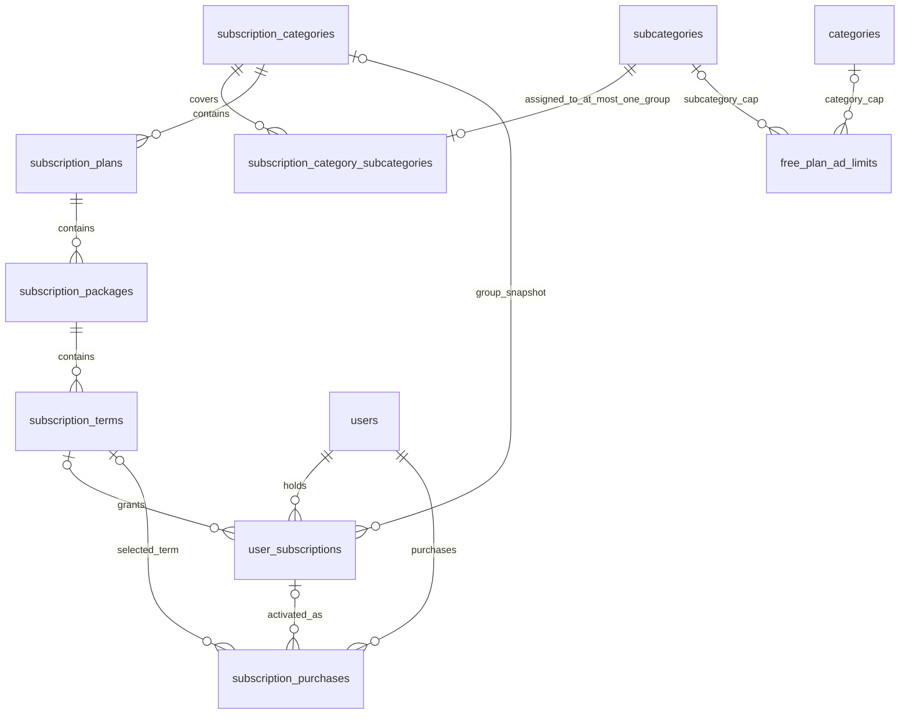
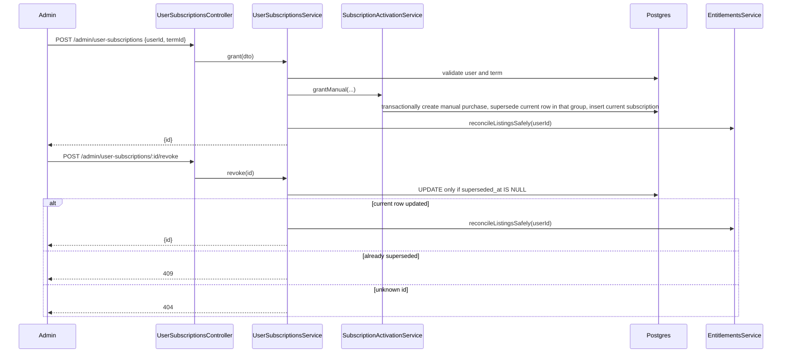

# Subscriptions module

Admin-managed subscription groups, their offer catalog, the free-plan allowance, and user subscription history. Users can also buy catalog offers through the payment module; this module owns the admin configuration and grant/revoke surface.

## Architecture

### Group scope is the allowance boundary

A subscription category is called a **group** in the API and application model. Each listing subcategory belongs to at most one group; a held subscription applies to all ads in that group's scope, while ads outside held groups use their free-plan cap. The database retains the historical `subscription_categories` table name.

| Table                                 | Purpose                                                                                                             |
| ------------------------------------- | ------------------------------------------------------------------------------------------------------------------- |
| `subscription_categories`             | Admin-managed groups, with a name, slug, ordering, and active flag.                                                 |
| `subscription_category_subcategories` | Group-to-listing-subcategory scope; the unique subcategory index prevents overlapping groups.                       |
| `subscription_plans`                  | Named plans within a group; slug is unique within its group.                                                        |
| `subscription_packages`               | Feature limits for a plan (`photos`, `ads`, `renews`, `autoRenews`, `videos`).                                      |
| `subscription_terms`                  | Purchasable price and duration options for a package.                                                               |
| `free_plan_settings`                  | Singleton account-wide free limits and the shared `otherAds` cap.                                                   |
| `free_plan_ad_limits`                 | Optional free ad cap for exactly one listing category or subcategory.                                               |
| `user_subscriptions`                  | Granted subscription history, with a purchase-time price and expiry; superseding/revoking is recorded, not deleted. |
| `subscription_purchases`              | Checkout/manual-comp record, including the frozen offer snapshot and payment linkage.                               |

Full field definitions and constraints are in [`../../db/schema/subscriptions.schema.ts`](../../db/schema/subscriptions.schema.ts). The admin controllers and services are in this directory; allowance calculation and periodic reconciliation live in [`../../subscriptions/`](../../subscriptions/).

### Entity map



### Where the queue and the outbox fit

Admin configuration changes enqueue a `listing-restriction-sweep` job on the `entitlements` BullMQ queue. A burst of edits collapses into one _waiting_ job (fixed `jobId`); an edit made while that job is already _running_ goes to a second `-next` job that waits behind it, because the running one may have read the config before the edit — so at most one job runs and one waits. `EntitlementsScheduler` (`entitlements.scheduler.ts`) owns the queue dependency; `EntitlementsProcessor` runs the same reconciliation used by the recurring 10-minute sweep. Enqueue errors are logged and swallowed because the recurring sweep is the backstop. Per-user entitlement changes caused by grant, payment activation, or revoke reconcile that user directly.

This module deliberately skips the transactional outbox: a reconciliation is derived work that can be recomputed from Postgres configuration and current subscriptions, and the recurring sweep repairs a missed enqueue. Payment processing does use the outbox for durable payment-to-queue handoff; see [`../../payment/README.md`](../../payment/README.md).

## Lifecycle, end to end

### Group scope edit and reconciliation

```mermaid
sequenceDiagram
    participant Admin
    participant Controller as SubscriptionConfigController
    participant Config as SubscriptionConfigService
    participant DB as Postgres
    participant Queue as EntitlementsScheduler / BullMQ
    participant Worker as EntitlementsProcessor
    participant Entitlements as EntitlementsService

    Admin->>Controller: PUT /admin/subscriptions/categories/:id/scope
    Controller->>Config: updateCategoryScope(id, subcategoryIds)
    Config->>DB: BEGIN; lock group row; reject scope owned by another group
    Config->>DB: replace subscription_category_subcategories
    Note over DB: Unique subcategory index closes the concurrent-edit race
    DB-->>Config: COMMIT (23505 is reported as 409)
    Config->>Queue: enqueue listing-restriction-sweep (waiting job, or -next if one is running)
    Queue-->>Worker: process job
    Worker->>Entitlements: reconcileAll()
    Entitlements->>DB: find candidate owners, then load each user's current allowance and live ads
    Entitlements->>DB: guarded active/restricted updates by ad id, owner, and expected status
```

### Free plan replacement

```mermaid
sequenceDiagram
    participant Admin
    participant Controller as SubscriptionConfigController
    participant Config as SubscriptionConfigService
    participant DB as Postgres
    participant Queue as EntitlementsScheduler

    Admin->>Controller: PUT /admin/subscriptions/free-plan
    Controller->>Config: updateFreePlan(settings, adLimits)
    Config->>Config: validate exclusive scope and reject duplicate caps
    Config->>DB: BEGIN; upsert singleton settings; delete and replace all free caps
    DB-->>Config: COMMIT (23505 becomes a truthful 409)
    Config->>Queue: enqueue listing-restriction-sweep
    Config->>DB: read saved settings and caps
    Config-->>Admin: saved free plan
```

### Grant, revoke, and history



Key properties this gives us:

- **One current subscription per non-null group.** A partial unique index enforces `(user_id, subscription_category_id)` while `superseded_at IS NULL`; different groups can be held side by side. PostgreSQL treats `NULL` values as distinct, so uncategorized legacy rows are not covered by that uniqueness rule.
- **Scope edits cannot silently move coverage.** The service refuses a scope already assigned elsewhere; the unique index remains the final guard against concurrent edits. A conflict is a 409, not a silent reassignment.
- **Free-plan settings and caps change atomically.** A failed replacement rolls back both the singleton settings row and the full cap list.
- **Subscription history is durable.** Upgrades, replacements, expiry transitions, and revokes set `superseded_at`/`superseded_reason`; revoke is an atomic conditional update and does not delete the purchase link.
- **Limit reconciliation is race-guarded.** It only restores rows still `restricted` and restricts rows still `active`, for the target owner; returned counts reflect rows actually changed.
- **Queue work is recoverable, not authoritative.** Postgres holds the current config and entitlement state. A failed admin enqueue delays correction until the recurring sweep rather than losing the source state.
- **Offer values are snapshots.** Purchase snapshots preserve offer limits and group identity when the catalog changes; the current group scope remains admin-managed and applies to holders of that group.

## Current state

| Piece                                                           | Status                                                                                                 |
| --------------------------------------------------------------- | ------------------------------------------------------------------------------------------------------ |
| Group, plan, package, and term admin CRUD                       | Done.                                                                                                  |
| Group scope replacement and overlap conflict                    | Done; transactional replacement plus unique-index conflict mapping.                                    |
| Free-plan settings and category/subcategory caps                | Done; validated and replaced in one transaction.                                                       |
| Public catalog, public free-plan sheet, and caller entitlements | Done.                                                                                                  |
| User subscription grant and revoke                              | Done; manual grants use the activation transaction; revoke preserves history and reconciles the owner. |
| Paid checkout and activation                                    | Done; payment settlement activates the frozen purchase through `SubscriptionActivationService`.        |
| Current/history status                                          | Done; status is derived from expiry/supersede fields, with typed supersede reasons.                    |
| Admin configuration reconciliation                              | Done; BullMQ job (one running + one waiting) plus the 10-min sweep.                                          |
| Video and auto-renew enforcement                                | Not started; values are stored/displayed but no feature consumes them.                                 |
| Admin reporting for failed outbox events                        | Not part of subscriptions; separately tracked as an outbox operational gap.                            |

## Open items

- **Two package counters are not enforced.** `autoRenews` and `videos` are stored and shown in admin/free-plan configuration, but listing lifecycle code has no auto-renew or video field to spend them against. Do not present them as enforced benefits until those features exist.
- **The dev demo account may have restricted listings.** The 2026-10-21 ship log reported that most of the admin demo owner's 74 live listings were restricted by free caps. This depends on shared-dev data; verify before changing group scopes or treating the demo account as representative.
- **A legacy test group may have no scope.** The same ship log reported an `Auto 8137` group with three subscribers and no covered subcategories. Those rows therefore receive no group allowance; confirm whether that shared-dev fixture still exists and either assign scope or retire it deliberately.
- **Deleting a group can strand existing subscriptions.** The schema sets `user_subscriptions.subscription_category_id` to null when its group is deleted, and the group deletion cascades through plans/terms. Entitlement loading ignores rows with a null group, so existing holders can lose their allowance. The admin delete path currently does not require migrating or explicitly revoking those subscriptions first.
- **Entitlement checks reload small config tables per call.** `EntitlementsService` currently performs several reads per check, including during publish. This is acceptable at current scale; measure before introducing caching, since invalidation must account for group-scope and free-plan edits.
