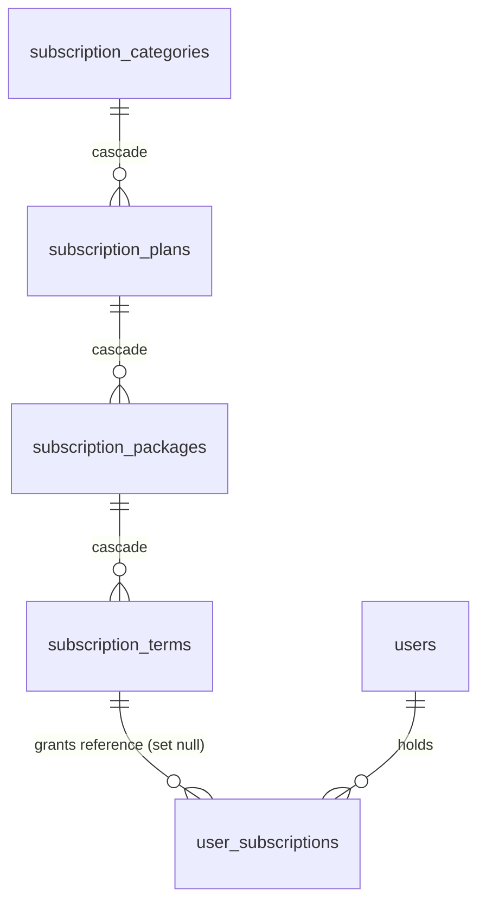
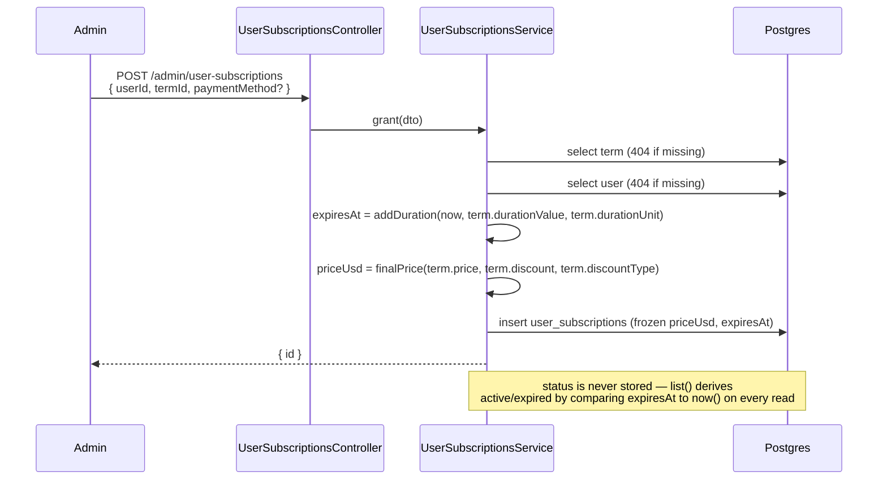

# Subscriptions module

Admin-managed catalog of subscription tiers (a 4-level cascade: category →
plan → package → term) plus a manual "grant a term to a user" action. There
is no self-serve checkout yet — every subscription today exists because an
admin created it, so this is a billing catalog and grant tool, not a
subscription engine.

## Architecture

### Config is a cascade, grants are a frozen leaf

`subscription_categories → subscription_plans → subscription_packages → subscription_terms`
cascade-delete top to bottom — deleting a category wipes every plan,
package, and term beneath it. `user_subscriptions` deliberately sits
outside that cascade: it references a term (nullable, `SET NULL` on
delete) and a user (`cascade`), but everything about the grant itself —
`priceUsd` — is computed once via `finalPrice(term.price, term.discount,
term.discountType)` at grant time and stored as a snapshot. Editing a
term's price later never touches an existing grant.

Two services split the same schema by concern: `SubscriptionConfigService`
owns the cascade (categories/plans/packages/terms CRUD), and
`UserSubscriptionsService` owns grants (list/grant/remove). Both are
registered straight into `AdminModule`, per this repo's convention for
admin-only features — there's no standalone `SubscriptionsModule`.

| Table                     | Purpose                                                                                                            |
| ------------------------- | ------------------------------------------------------------------------------------------------------------------ |
| `subscription_categories` | Top of the cascade — e.g. "Ads Boost". Slug-unique, sortable, admin-managed.                                       |
| `subscription_plans`      | Named plan under a category. Slug unique per-category (`(categoryId, slug)`), not globally.                        |
| `subscription_packages`   | A plan's feature bundle — integer counters (`photos`, `ads`, `renews`, `autoRenews`, `videos`).                    |
| `subscription_terms`      | A package's purchasable duration/price combo (`durationValue`+`durationUnit`, `price`, `discount`/`discountType`). |
| `user_subscriptions`      | One grant: a user holding a term, with a frozen `priceUsd` and a derived (not stored) status.                      |

Full field-level definitions are in
[`../../db/schema/subscriptions.schema.ts`](../../db/schema/subscriptions.schema.ts).

### Entity map

### Where the queue and the outbox fit

Neither. A grant is a single synchronous insert from an admin action —
there's no external system to hand off to and no other module needs to
react to a grant happening, so there's nothing for BullMQ or the outbox
(`src/outbox/`) to do here today. That changes the moment a grant can be
triggered by a payment instead of an admin click — see Open items.

## Lifecycle, end to end

Key properties this gives us:

- **Price is a snapshot, not a live join.** Once granted, a subscription's
  `priceUsd` is immune to the admin later editing the term's price or
  discount — what the user was charged (or would have been) stays fixed.
- **Status is always fresh, never stale.** There's no `status` column to
  forget to update on expiry — `expiresAt < now()` is the only source of
  truth, computed at read time in `UserSubscriptionsService.list()` and
  again in `AdminService.getStats()`'s premium-user `EXISTS` check.
- **A grant survives its own catalog being deleted.** Removing a plan (and
  therefore its packages/terms via cascade) only nulls out
  `user_subscriptions.termId` — the grant row, its frozen price, and its
  `expiresAt` all remain.
- **`paymentMethod` is a label, not a record.** It's a free-text string the
  admin types (`"cash"`, `"bank transfer"`) — nothing validates it, and
  nothing ties it to an actual transaction anywhere in the system.

## Current state

| Piece                                                 | Status                                                             |
| ----------------------------------------------------- | ------------------------------------------------------------------ |
| 4-tier config CRUD (categories/plans/packages/terms)  | Done.                                                              |
| Grant / list / remove a user subscription             | Done.                                                              |
| Derived active/expired status                         | Done.                                                              |
| Admin stats premium-user derivation                   | Done — `AdminService.getStats()` reads this table via an `EXISTS`. |
| Self-serve checkout (user picks and pays for a plan)  | Not started.                                                       |
| Payment linkage (`payment_transactions` ↔ this table) | Not started — see Open items.                                      |
| Live auto-renew execution                             | Not started — `autoRenews` is a feature-count field, not a job.    |

## Open items

- **No payment linkage exists.** `user_subscriptions.paymentMethod` is a
  free-text label an admin types by hand; there's no FK from
  `user_subscriptions` (or a new join table) to `payment_transactions`.
  This is the specific gap the payment module's ledger design needs to
  close to make a subscription purchase go through real payment
  processing instead of an admin-typed comp grant.
- **`autoRenews` doesn't do anything yet.** It's an integer on
  `subscription_packages` describing how many auto-renews the package
  permits — no scheduled job reads it or actually renews an expiring
  `user_subscriptions` row.
- **No user-facing subscribe flow.** Every grant today is
  `POST /admin/user-subscriptions`, an admin-only route. A self-serve
  `POST /subscriptions/checkout` (or similar) doesn't exist.
- **`subscriptionPlans.slug` is unique per-category, not globally.** Fine
  for the current admin-only surface; a future public catalog endpoint
  keyed by slug alone would need the category id too.
