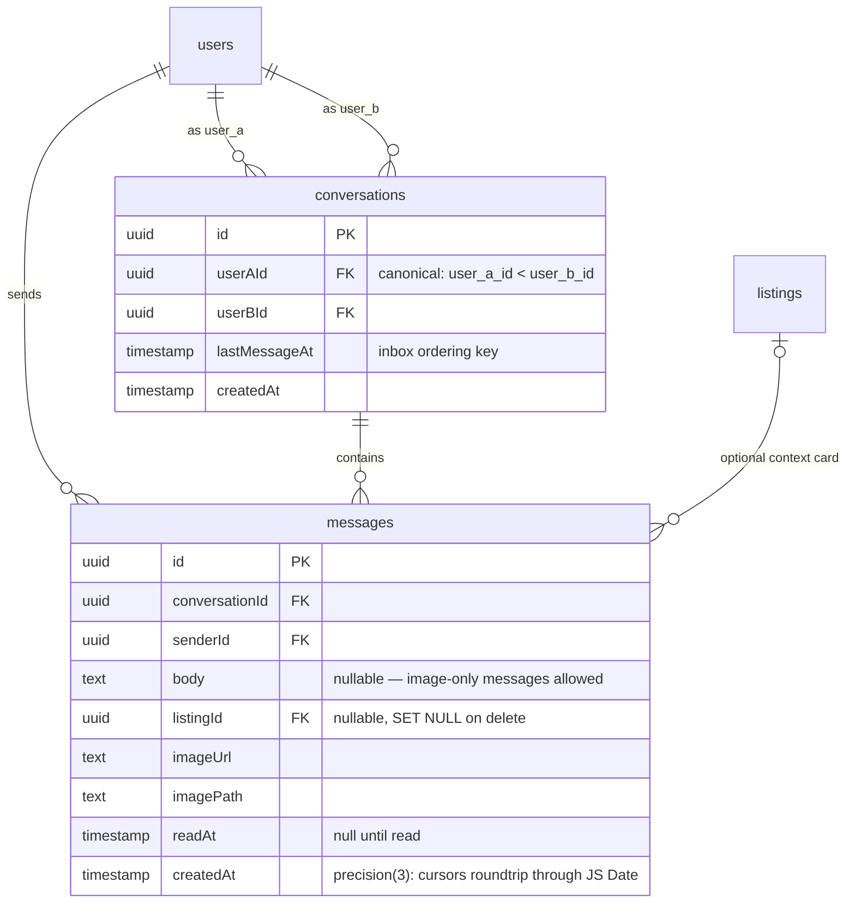
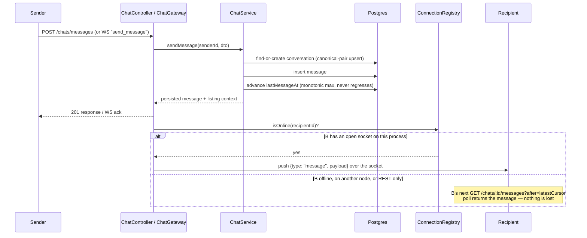
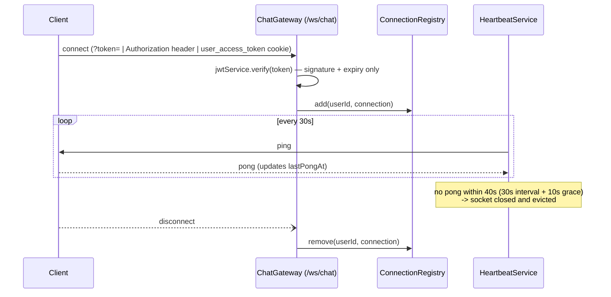

# Chat module

1:1 buyer↔seller messaging. REST is the source of truth for every read and
write; a WebSocket gateway sits alongside it as an optional low-latency push
— not a replacement for polling, a shortcut on top of it.

## Architecture

### REST is authoritative, the socket is a shortcut

Every message is written through `ChatService.sendMessage`, whether the
request arrived over `POST /chats/messages` or the WS `send_message` event —
the gateway calls the exact same service method, so validation (self-message,
empty body, blocked pair, listing ownership, chat-image path ownership) only
exists once. The socket's only job on top of that write is: if the recipient
happens to have an open connection _to this process_, push the already-
persisted message to them immediately. If they don't — wrong node, offline,
REST-only client — nothing is lost, because the client's next
`GET /chats/:id/messages?after=<latestCursor>` poll picks it up. The socket
is a latency optimization on a system that already works without it.

### Files

| File                     | Purpose                                                                                                                            |
| ------------------------ | ---------------------------------------------------------------------------------------------------------------------------------- |
| `chat.controller.ts`     | REST surface: send, inbox, unread-count, resolve-with-user, message history/poll, mark-read.                                       |
| `chat.service.ts`        | All persistence + business rules. The single write path for a message, REST or WS.                                                 |
| `chat.gateway.ts`        | WebSocket gateway (`/ws/chat`). Authenticates the socket, relays `send_message` into `ChatService`, pushes to an online recipient. |
| `connection-registry.ts` | In-memory `userId -> sockets` map for this process. Answers "is this user online, and on which socket(s)."                         |
| `heartbeat.service.ts`   | Pings every open socket every 30s; closes and evicts any that hasn't ponged in 40s.                                                |
| `chat.types.ts`          | Response-shape interfaces (`InboxItem`, `MessageWithListing`, poll metadata) shared by the service and controller.                 |
| `dto/`                   | `SendMessageDto`, `QueryChatsDto`, `QueryMessagesDto` — request validation.                                                        |

DB schema lives in [`../db/schema/chat.schema.ts`](../db/schema/chat.schema.ts), not in this folder.

### Entity map

One `conversations` row per unordered pair, enforced by a CHECK
(`user_a_id < user_b_id`) plus a unique index on the pair — there is no
"start a new thread with the same person" possible, by construction.

### Where this differs from the payment module's approach

Chat doesn't use the transactional outbox or a BullMQ queue at all — every
write is synchronous, inline, in the request/WS-handler that received it.
That works because chat has no external system to hand off to; the WS push
in `chat.gateway.ts` is the closest thing to an async fan-out step, and it's
best-effort (fire-and-forget over a live socket), not durable like an
outbox row.

## Lifecycle, end to end

### Sending and receiving a message

### WebSocket connection lifecycle

Key properties this gives us:

- **The socket can disappear entirely and nothing breaks.** Delivery
  correctness lives in the DB write + cursor polling; the socket only
  affects _how fast_ the recipient finds out.
- **Read receipts are pull-based, not pushed.** `markRead` bulk-updates
  `readAt`; the sender learns about it via `peerLastReadAt` on their next
  poll, not a socket event — there is no separate read-receipt push path
  today.
- **A forged/expired cursor can't leak across conversations.** Every cursor
  comparison is scoped inside a conversation the caller was already
  authorized for in the same query.

## Current state

| Piece                                                             | Status                                                                                       |
| ----------------------------------------------------------------- | -------------------------------------------------------------------------------------------- |
| REST endpoints (send / inbox / unread / resolve / history / read) | Done.                                                                                        |
| DB schema (`conversations`, `messages`)                           | Done, migrated.                                                                              |
| Blocking enforcement (403 either direction)                       | Done.                                                                                        |
| Cursor pagination + `after` delta polling                         | Done.                                                                                        |
| WebSocket gateway (real-time push)                                | Done — but single-instance only (see Open items).                                            |
| Heartbeat / stale-connection sweep                                | Done.                                                                                        |
| Multi-instance WS fan-out                                         | Not started — `ConnectionRegistry` is a local `Map`, not backed by Redis pub/sub or similar. |
| WS auth parity with REST                                          | Not started — see Open items.                                                                |
| WS-path rate limiting                                             | Not started — `@Throttle` only guards the REST route.                                        |
| Push notifications (FCM/APNs)                                     | Not started.                                                                                 |
| Message delete / private chat-image bucket                        | Not started, by design (see the repo's known-gaps notes).                                    |

## Open items

- **`ConnectionRegistry` doesn't survive more than one backend process.**
  It's an in-memory `Map`, so real-time push only reaches a recipient
  connected to the _same_ instance as the sender. Correctness doesn't
  depend on it (REST + polling still delivers everything), but running more
  than one instance silently degrades "instant" delivery to "next poll" for
  cross-instance pairs. Needs a shared layer (Redis pub/sub, or similar)
  before that's a deliberate tradeoff rather than an accident.
- **WS auth is weaker than REST auth.** `ChatGateway.handleConnection` calls
  `JwtService.verify()` directly — signature and expiry only. The REST path
  goes through `JwtAuthGuard` → `JwtStrategy.validate`, which also checks the
  DB for a soft-deleted user. A user who gets soft-deleted (or loses access)
  keeps a working socket until their access token's own expiry
  (`JWT_ACCESS_EXPIRES_IN`, default 15m).
- **No rate limit on the WS `send_message` event.** The REST
  `POST /chats/messages` route has a tighter-than-global throttle (30/min)
  specifically because sending is the harassment/spam surface; the WS event
  bypasses it entirely since it never goes through `ThrottlerGuard`.
- **This module has outgrown its own docs.** The root `CLAUDE.md` still
  describes chat as "REST + polling (no WebSockets)" — worth a follow-up
  pass there now that `chat.gateway.ts` exists.
