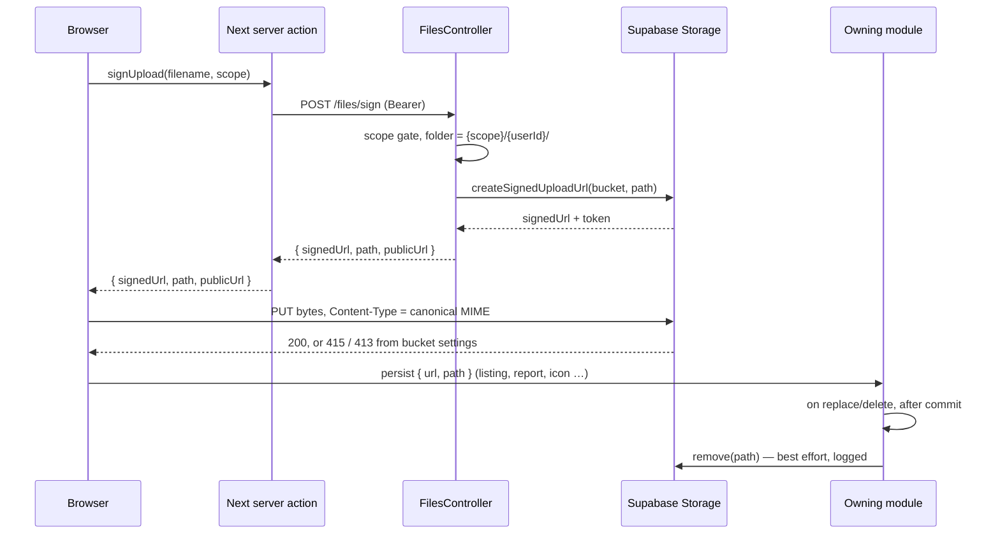

# Files

`FilesModule` issues Supabase Storage upload grants and owns object cleanup for every public upload surface — listing photos, report evidence, feedback images, avatars/covers and the admin catalogue. It never proxies image bytes: clients PUT directly to Storage, which is the enforcement point for type and size.

## Architecture

### Sign, don't proxy

The module's core invariant is that the backend hands out signed upload URLs and derives object paths, but the bytes never pass through Nest. Large uploads stay off the API process, and Supabase's own bucket settings (allow-list + size cap) are authoritative. The one deliberate exception is server-side multipart upload for surfaces a client cannot grant: anonymous feedback (`FilesService.uploadPublic`, via `FeedbackService`) and avatar/cover (`UsersService.validateImageFile`), both buffered by multer and capped at 5 MB raster-only.

| File                                                 | Role                                                                                            |
| ---------------------------------------------------- | ----------------------------------------------------------------------------------------------- |
| `files.controller.ts`                                | `POST /files/sign` (scope + staff gate, folder derivation) and `DELETE /files` (ownership gate) |
| `files.service.ts`                                   | Signed upload/download URLs, object path derivation, ownership tests, best-effort cleanup       |
| `files.module.ts`                                    | Module wiring                                                                                   |
| `files.controller.spec.ts` / `files.service.spec.ts` | Scope/staff/ownership and URL-derivation unit tests                                             |

Bucket layout:

| Bucket                                                                   | Used by                                  | Limits                                                                                                                                             |
| ------------------------------------------------------------------------ | ---------------------------------------- | -------------------------------------------------------------------------------------------------------------------------------------------------- |
| default (`SUPABASE_STORAGE_BUCKET`; `product-images` in this deployment) | signed uploads + feedback + avatar/cover | public; allow-list `image/jpeg,image/jpg,image/png,image/gif,image/webp,image/heic,image/heif,image/x-adobe-dng,image/dng`; 50 MB cap (2026-11-02) |
| `chat-files`                                                             | encrypted chat attachments               | private; `application/octet-stream`; 25 MB — `docs/e2e-attachments.md`                                                                             |
| `resume-files`                                                           | CV files                                 | private; PDF/Word — the resume module                                                                                                              |

No entity map: the module owns no database tables. `listing_photos`, report `image_paths`, `feedback.image_paths` and the catalogue `icon`/`image` columns live in their owning modules; `FilesService` only derives paths and deletes objects.

Cross-cutting mechanisms: **none**. No transactional outbox and no BullMQ queue — every operation is a single Storage call or a best-effort sweep triggered by a DB write. `FilesService.remove` logs a warning and never throws, because storage is not transactional with Postgres: cleanup runs after commit, gated on the value actually changing, and a Supabase hiccup must not fail the database operation.

### The upload contract

`POST /api/v1/files/sign` (JWT) takes `{ filename, scope }` and returns `{ signedUrl, path, token, publicUrl }` for `{folder}/{uuid}-{safeName}`.

| Scope                                                                                              | Folder                  |
| -------------------------------------------------------------------------------------------------- | ----------------------- |
| User scopes: `avatar`, `cover`, `listing`, `chat`, `report`                                        | `{scope}/{userId}/`     |
| Staff scopes: `category`, `subcategory`, `brand`, `model`, `product`, `attribute`, `advertisement` | `{scope}/` (staff only) |

`DELETE /files` accepts up to 50 paths. Non-staff callers may delete only objects inside their own folders (`isOwnedPath` recognizes the five public-bucket user scopes and rejects `..` traversal); CV attachments live in the private `resume-files` bucket and are owned by the resume module's own service (`POST /resume/attachments/sign`).

The bucket's allow-list and 50 MB cap are **Supabase-side settings** (Dashboard → Storage → the bucket → Edit bucket), not application code — the backend only signs. Until 2026-11-02 the bucket allowed only jpeg/png/webp at 5 MB, so the listing form's promised gif/heic/heif/dng uploads failed at Storage with `415 invalid_mime_type` (or `413` above 5 MB). Widening the bucket is what makes the advertised formats work.

The web client contract lives in `apps/web/lib/upload.ts`: `UPLOAD_MIME_BY_EXT` (extension → canonical MIME), `UPLOAD_ACCEPT`, `MAX_UPLOAD_BYTES` and `resolveUploadMime(file)`. The PUT must declare the canonical type because browsers are inconsistent (`.dng` often arrives as `application/octet-stream`, `.jpg` as `image/jpg`), and Storage validates the declared Content-Type. `components/post/ImageUpload.tsx` and `components/report/ReportAccount.tsx` pre-validate before signing and toast a specific unsupported-format or max-size message. Adding a format means updating the bucket **and** `UPLOAD_MIME_BY_EXT` together.

## Lifecycle, end to end

Key properties this gives us:

- Bytes never touch the API process, so upload bandwidth and memory stay on Supabase.
- Storage is the single enforcement point for MIME and size; `/files/sign` deliberately does not validate them.
- Ownership is proven by the folder prefix, which is also how `DELETE /files` and listing-photo cleanup reject other users' objects.
- Cleanup is post-commit and best-effort: orphaned objects are possible (and logged), but a storage failure can never fail a DB write.
- The web pre-check mirrors the bucket so users see a reason instead of a failed PUT.

## Current state

| Piece                                          | Status                                                       |
| ---------------------------------------------- | ------------------------------------------------------------ |
| Signed upload URLs (`/files/sign`)             | Done — scopes, per-user folders, staff gate                  |
| Signed download URLs                           | Done — `createSignedDownloadUrl` (resume/chat consumers)     |
| Path-based delete (`DELETE /files`)            | Done — 50-path cap, own-folder check, traversal rejection    |
| Bucket allow-list / 50 MB cap                  | Done — Supabase setting, widened 2026-11-02                  |
| Web client contract + pre-validation           | Done — `apps/web/lib/upload.ts`, post form and report picker |
| Server-side multipart (feedback, avatar/cover) | Done — 5 MB raster-only (`jpeg/png/webp/gif/avif`)           |
| Server-side validation of signed uploads       | Not started — by design; bytes bypass the API                |
| Mobile client contract                         | Not started — sends the raw `file.type`                      |

Verification recipe (2026-11-02): mint a dev-OTP user session, sign a `listing` upload, then PUT one tiny file per advertised extension with its canonical Content-Type. Every advertised format returned 200; 6 MB returned 200; 51 MB returned `413 EntityTooLarge`. Probe objects were deleted through `DELETE /files`.

## Open items

- **Mobile does not normalize MIME.** `apps/mobile` sends the raw `file.type`, so a `.dng`/`.heic` the OS reports as `application/octet-stream` will still be refused by Storage even though the web accepts it. Port `resolveUploadMime` (or share it) before claiming mobile format parity.
- **HEIC/HEIF/DNG do not render in Chromium.** Uploads succeed, but Chrome/Edge cannot decode them in ``, so the preview and public listing show the app's no-image state there; Safari renders HEIC. Converting to WebP client-side would need a decoder dependency, which the repo does not carry.
- **The server-side multipart path still enforces 5 MB and its own type list** (`jpeg/png/webp/gif/avif`). That contract is separate from the bucket: feedback images and avatar/cover uploads are unaffected by the 50 MB widening.
- **Cleanup wiring is incomplete.** Not wired for admin user soft-delete, chat images (no message-delete endpoint by design) or listing soft-delete (restore must work); objects under the old flat `listing/…` paths are never cleaned.
- **Stale doc references.** `ARCHITECTURE.md` §Files lists an older scope set (missing `report`, `product`, `advertisement`); this README is the current contract. `resume` was removed from `/files/sign` on 2026-11-03 (it had no MIME/size check there and fell into the public bucket); CVs use `POST /resume/attachments/sign` against the private `resume-files` bucket.
