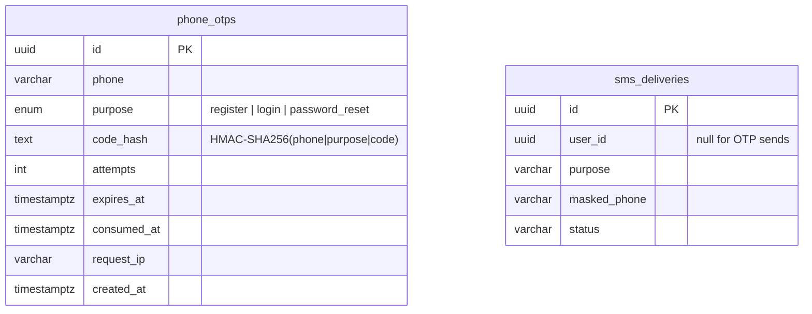
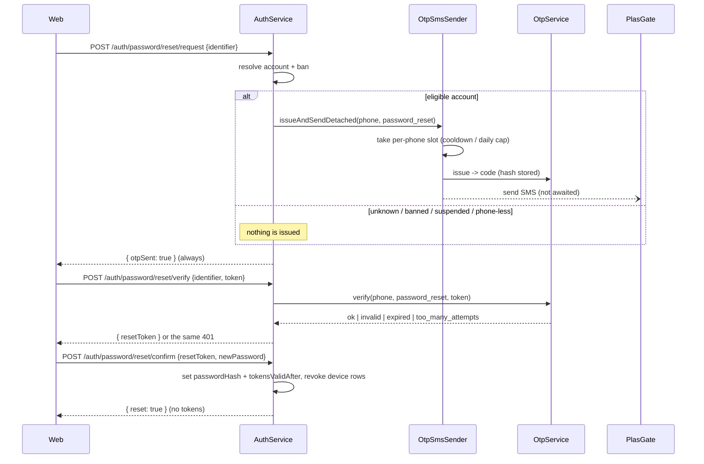

# OTP module

Issues, checks and delivers phone one-time codes (register, login-by-OTP, password reset) on our own backend instead of Supabase, behind the `OTP_PROVIDER` switch. Delivery is a direct PlasGate call, never the notification outbox.

## Architecture

### The code never leaves the request path

A one-time code is a secret, and the account it protects may not exist yet. The notification SMS pipeline cannot carry it: the outbox would keep the message (and so the code) in `outbox_events.payload` until the event is terminal, and its SMS rows are keyed on `users.id`, which a registering phone does not have. So this module owns three things end to end: the code (`OtpService`), its storage (`phone_otps`, hash only), and the send (`OtpSmsSender` over `PlasGateClient`). The code exists in plaintext only in the memory of one request and in the SMS.

| File                                | Purpose                                                                                                                                                                                              |
| ----------------------------------- | ---------------------------------------------------------------------------------------------------------------------------------------------------------------------------------------------------- |
| `otp.service.ts`                    | `issue` / `verify` / `invalidate`. 6 digits via `crypto.randomInt`, HMAC-SHA256 hash, `timingSafeEqual`, 5 min expiry, 5 attempts, single use, `DEV_OTP_TOKEN` bypass (ignored in production).       |
| `otp.repository.ts`                 | The conditional `UPDATE ... RETURNING` statements that make attempts and single-use atomic (`replaceOpen`, `findLatestOpen`, `reserveAttempt`, `consume`, `invalidate`).                             |
| `otp-sms-sender.ts`                 | Per-phone limits (`SmsUserLimiter`), global budget (`SmsRateLimiter`), PlasGate send with one in-request retry, masked audit row in `sms_deliveries`. Also `issueAndSendDetached` and `reserveOnly`. |
| `otp.types.ts`                      | Purposes, limits (`OTP_TTL_MS`, `OTP_MAX_ATTEMPTS`), result types.                                                                                                                                   |
| `otp.module.ts`                     | Imports `NotificationsModule` for the PlasGate client and the SMS limiters; exports `OtpService` and `OtpSmsSender` to `AuthModule`.                                                                 |
| `../db/schema/phone-otps.schema.ts` | The only table: `phone_otps` (phone, purpose, `code_hash`, attempts, `expires_at`, `consumed_at`, `request_ip`).                                                                                     |

### Entity map

`phone_otps` has no foreign keys on purpose (the phone may belong to no user). OTP audit rows in `sms_deliveries` have a null `user_id`, a masked phone and no message text.

### Outbox and queues

Uses neither, deliberately. The outbox is skipped for the secret-in-payload and no-user-row reasons above; BullMQ is skipped because a code must be delivered inside the request (the user is waiting, and a late code is worse than a failed send that releases the cooldown). Redis is touched only through the shared SMS limiters, and they fail closed.

## Lifecycle, end to end

The shipped reset flow is the three-step `POST /auth/password/reset/request|verify|confirm` surface in `AuthService`; under `OTP_PROVIDER=plasgate` its request and verify steps use this module. The plan's two-endpoint `/auth/password/forgot|reset` design is not exposed.

Key properties this gives us:

- The attempt is spent before the compare, so parallel guesses cannot exceed 5; `consume` is a conditional update, so two correct submissions let exactly one through.
- A limiter slot is taken before a code is issued, so a request over the limit cannot replace the code the user already received.
- A send that fails (PlasGate rejects, not configured, global budget) releases the slot and invalidates the code, so the user can retry at once.
- The reset request answers the same for every identifier: same lookups, the PlasGate call is not awaited, and limiter outcomes (cooldown/cap) are swallowed rather than returned — a 429 would reveal that the identifier resolves to an account. Trade-off: a user over the cooldown sees success but gets no SMS.
- The reset flow opts out of `DEV_OTP_TOKEN` (`devBypass: false`), so it always issues and checks a real code; register/resend/login keep the dev convenience.
- Register, resend and login-OTP use `issueAndSend` (awaited) and map failures to 429 `OTP_COOLDOWN` / `OTP_DAILY_CAP` or 503 `OTP_SEND_FAILED`.

## Current state

| Piece                                                        | Status                                                                     |
| ------------------------------------------------------------ | -------------------------------------------------------------------------- |
| `OtpService` (issue / verify, hashing, attempts, single use) | Done                                                                       |
| `OtpSmsSender` (limits, PlasGate send, audit row)            | Done                                                                       |
| Register / resend / login-OTP / verify on `plasgate`         | Done, behind `OTP_PROVIDER` (default `supabase`)                           |
| Forgot password + reset + session revocation                 | Wired into the three-step reset on `plasgate`; Supabase path unchanged     |
| Phone-change OTP                                             | Not started: still `SupabaseService` in `users.service.ts`                 |
| Web: forgot-password pages                                   | Done; the resend timer is local (this flow returns no `retryAfterSeconds`) |
| Real-SMS rollout and brute-force pass                        | Not started (plan task 1.7)                                                |
| Expired-row cleanup                                          | Not started                                                                |

## Open items

- **Phone-change still uses Supabase OTP.** `UsersService.requestPhoneChangeOtp` / `verifyPhoneChangeOtp` ignore `OTP_PROVIDER`, so a number can be moved without the own-OTP limits. Same one-line swap as the others, left out of scope on purpose.
- **Limits are per phone and shared with the SMS plan.** The cooldown and daily cap reuse `SMS_USER_COOLDOWN_SECONDS` and `SMS_USER_DAILY_CAP`; there are no separate `OTP_*` variables. Tuning OTP alone means adding config.
- **`phone_otps` is never purged.** Consumed and expired rows accumulate (hash only, so no secret risk). A sweeper, like the one for `outbox_events`, is not written.
- **`OTP_HMAC_SECRET` falls back to a key derived from `JWT_SECRET`** with a warning. Rotating `JWT_SECRET` then silently invalidates open codes; set a separate `OTP_HMAC_SECRET` in every environment.
- **Per-IP throttles are in-memory and per instance** (`SMS_LIMIT` 5/min, `CREDENTIAL_LIMIT` 10/min), and behind the web server-action proxy many users can share one IP. The per-phone limits and the 5-attempt cap are the real controls.
- **Detached delivery is fire-and-forget.** If the process exits between the response and the PlasGate call the code is stored but never sent; the user waits out the cooldown. Acceptable for MVP, noted for the rollout pass.
- **Residual timing difference in forgot-password** (one DB insert, a few ms) is not padded; measure it in the rollout pass (task 1.7) before claiming it is unobservable.
- **`UsersService.changePassword` sets `users.tokensValidAfter`** (since 2026-11-03), so a settings password change ends older sessions and any outstanding reset proof (see `ARCHITECTURE.md`, Session revocation); device rows are not deleted there, only cut off by the cutoff.
