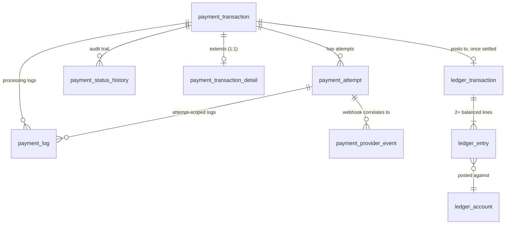

# Payment module

Handles payment processing (talking to a gateway) and posts settled money
movement to an internal double-entry ledger. The two are deliberately kept
as separate table clusters — see [Architecture](#architecture) for why.

## Architecture

### The ledger boundary

A gateway integration is inherently messy: a card gets declined and retried,
a webhook arrives twice, a provider takes eleven seconds and the client
already gave up. That mess needs somewhere to live — it lives in the
**processing layer**. The **ledger** can't be messy: every transaction's
debits must equal its credits, nothing is ever edited in place (only
reversed with a new entry), and the record must read the same regardless of
which gateway or retry path produced it.

So the ledger is a separate cluster that is only written to once a
`payment_transaction` actually reaches a terminal success state — never
while it's still in flight.

| Layer      | Table                         | Purpose                                                                                                                            |
| ---------- | ----------------------------- | ---------------------------------------------------------------------------------------------------------------------------------- |
| Processing | `payment_transactions`        | One row per operation (payment / capture / refund / void). The seam: the only table the API queries directly.                      |
| Processing | `payment_attempts`            | One row per try against a provider. A transaction can have several (declined card, retried method, retried after timeout).         |
| Processing | `payment_status_history`      | Audit trail of every status transition on a transaction, and who/what caused it.                                                   |
| Processing | `payment_provider_events`     | Inbound webhook intake, deduped on `(provider, providerEventId)`. The provider's inbox — mirror image of `outbox_events`.          |
| Processing | `payment_transaction_details` | 1:1 satellite for bulky/sensitive provider payload (masked account, redirect URL, raw response) — keeps the hot table lean.        |
| Processing | `payment_logs`                | Free-form operational/debug trail. Distinct from `payment_status_history`, which only ever records a business-state change.        |
| Ledger     | `ledger_accounts`             | Chart of accounts — what an entry can post against (customer wallets, platform revenue, provider clearing, tax payable).           |
| Ledger     | `ledger_transactions`         | A posted (or reversed) unit of bookkeeping. Created once, when a `payment_transaction` settles.                                    |
| Ledger     | `ledger_entries`              | The debit/credit lines under a `ledger_transaction`; must net to zero per currency — enforced in the service layer, not by the DB. |

Full field-level definitions are in [`entity/`](./entity).

Two more folders round out the module: [`use-cases/`](./use-cases) is the
actual business logic — `Effect.fn`-wrapped generators — split into two
subfolders that mirror the processing/ledger boundary above:
[`use-cases/payments/`](./use-cases/payments) (create/check/list/upsert a
transaction; create/list an attempt; enqueue a durable handoff; create a
provider event; process an attempt; process a provider event; poll an
attempt; a handful of small single-table reads/writes the processor needs)
and [`use-cases/ledgers/`](./use-cases/ledgers) (resolve-or-create a system
ledger account; post one balanced `ledger_transaction`; the chart-of-accounts
mapping that turns a settled `payment_transaction` into that posting). Every
use-case `yield*`s `DbClientTag` (`../db/db.provider.ts`) and, for the three
processor use-cases, `PaymentGatewayRegistryTag`
(`./providers/payment-gateway-registry.provider.ts`) instead of taking a
Drizzle client or the registry as a plain parameter, and fails with the
`Schema.TaggedError` classes in `use-cases/payments/errors.ts` /
`use-cases/ledgers/errors.ts` instead of throwing — the two error files are
separate (the ledger cluster's balance invariant has nothing to do with
payment-transaction lifecycle failures), and `payments/errors.ts` imports
`LedgerImbalanceError` from the ledger side only to fold it into
`PaymentProcessingError`, the union the three processor use-cases fail with.
The top-level [`use-cases/index.ts`](./use-cases/index.ts) re-exports both
subfolders together, so every other file in this module (and outside it)
still imports from one place — `from '../use-cases'` / `from './use-cases'`
— rather than reaching into either subfolder directly.
`PaymentsController` and `AbaPaywayController` share `PaymentEffectRunner`
(`payment-effect-runner.service.ts`) for the layer-provide/exit-handling
boilerplate: it provides `DbClientTag`, runs the effect with
`Effect.runPromiseExit`, and maps a typed failure to an `HttpException` via
`toHttpException` (`payment-http-exception.util.ts`) — an unmodeled defect
falls through to `GlobalExceptionFilter` as a 500. `PaymentProcessor`
(`./processors/payment.processor.ts`, the BullMQ consumer) does the
equivalent for its own use-cases, except a modeled failure is thrown rather
than mapped to HTTP — that's what asks BullMQ for a retry.
[`providers/`](./providers) is the gateway abstraction
(`PaymentGatewayProvider` interface + `PaymentGatewayRegistry`, resolving by
the plain `provider` string already on `payment_attempts`, plus an optional
`reconcile()` method for corroborating a webhook before trusting it — useful
for a provider that doesn't sign its callbacks, though any provider can
implement it for extra defense in depth). Each concrete gateway gets its own
subfolder with its own README documenting that provider's wire format,
signing scheme, and open questions — e.g.
[`providers/aba-payway/`](./providers/aba-payway); `payment.module.ts` wires
each one into `PAYMENT_GATEWAY_PROVIDERS`, and adding a new bank means
adding another folder there and one more entry in that factory.

### Entity map



### Where the queue and the outbox fit

The outbox and the BullMQ queue are used **together**, for two different
jobs, not as alternatives:

- **The transactional outbox** (`outbox_events`, `src/outbox/`) is the
  durable handoff from "the DB transaction committed" to "BullMQ has this
  job". `PaymentsController.create()` writes a `payment.attempt.requested`
  outbox row in the _same_ DB transaction as the `payment_transaction` +
  `payment_attempt` insert (`enqueuePaymentAttempt`,
  `use-cases/payments/enqueue-payment-attempt.use-case.ts`); `webhook()` and
  `AbaPaywayController.webhook()` do the same with a
  `payment.provider_event.received` row alongside the `payment_provider_event`
  insert. This is what a bare "insert, then `queue.add()`" can't give you: a
  crash between the two used to strand a committed attempt forever (see the
  git history on this file for the pre-outbox version). A provider with no
  webhook at all (Bakong — see
  [`providers/bakong/README.md`](./providers/bakong/README.md)) adds a
  third: `processPaymentAttempt` writes a `payment.attempt.poll_requested`
  row itself, from inside the BullMQ job, whenever `charge()` comes back
  `pending` with `ChargeResult.poll` set — and that use-case, unlike the
  other two producers, keeps re-writing this same event type on every
  "still nothing to report" round. Three thin `OutboxHandler`s
  (`outbox/payment-attempt-outbox-handler.ts`,
  `outbox/payment-event-outbox-handler.ts`,
  `outbox/payment-poll-outbox-handler.ts`) are the only things that read
  these rows — each does nothing but `queue.add()` the corresponding BullMQ
  job (the poll handler alone passes a `delay`) and report
  `published`/`retry` back to the outbox worker.
  **These three event types are internal DB→BullMQ plumbing only** — not to
  be confused with the _business-level_ `payment.succeeded` /
  `payment.refunded` outbox events described below, which don't exist yet.
- **BullMQ `payments` queue** (`PAYMENT_QUEUE`, defined in
  `payment.constants.ts` — deliberately not `payment.module.ts`, see Open
  items — against the shared Redis connection from `app.module.ts`) is the
  actual concurrent worker pool that calls a gateway. `PaymentProcessor`
  (`processors/payment.processor.ts`, this module's first `@Processor`)
  consumes all three job kinds and delegates to `processPaymentAttempt` /
  `processProviderEvent` / `pollPaymentAttempt`. `defaultJobOptions` (attempts + exponential
  backoff) come from `PAYMENT_JOB_ATTEMPTS` / `PAYMENT_JOB_BACKOFF_MS`;
  `PAYMENT_WORKER_CONCURRENCY` now drives `@Processor`'s own `concurrency`
  option (read from `process.env` directly, since Nest's DI container isn't
  up yet when the decorator evaluates).
- **A settled payment telling the rest of the system** (an outbox
  `payment.succeeded` / `payment.refunded` event that notifications or other
  modules subscribe to, written in the same DB transaction as the ledger
  posting) is a **separate, not-yet-built** use of the same `OutboxModule` —
  see [Current state](#current-state). The ledger posting itself (inserting
  `ledger_transaction` + `ledger_entries`) is built and runs in that same DB
  transaction today (`postPaymentSettlementLedger`, called from all three
  success-transition use-cases — see the lifecycle diagram below); only the
  outbox row announcing it to the rest of the system is not. Don't conflate
  either of these with the `payment.attempt.requested` /
  `payment.provider_event.received` plumbing above; same infrastructure,
  different purpose, different event types.
- **Notification emission is end-of-life only, and it's asymmetric with the
  outbox.** On the happy path, settlement writes an `outbox_event` _and_
  emits a notification — the outbox row is the durable "something happened"
  fact other modules can subscribe to later; the notification emit is the
  immediate "tell this user now" side effect. On the terminal-failure path
  there's no ledger posting, so there's no `outbox_event` either — failure
  notifications are emitted directly off the queue. A retryable failure
  (new `payment_attempt`, transaction still `pending`) never notifies; the
  transaction hasn't reached end-of-life yet. **Not built** — see
  [Current state](#current-state).

### Balance invariant

Nothing in the schema enforces that a `ledger_transaction`'s entries sum to
zero per currency — a Postgres `CHECK` constraint can't see sibling rows.
This has to be a single service-layer write path that always inserts
debit/credit pairs inside one DB transaction.

## Lifecycle, end to end

```mermaid
sequenceDiagram
    participant Client
    participant PaymentsController
    participant Outbox as outbox_events
    participant Worker as OutboxWorker
    participant BullMQ as BullMQ (payments)
    participant Processor as PaymentProcessor
    participant Provider as PaymentGatewayProvider
    participant Postgres
    participant Ledger as Ledger posting
    participant Notifier as Notification / Outbox

    Client->>PaymentsController: POST /payments
    PaymentsController->>Postgres: runInTransaction:<br/>insert payment_transaction (pending)<br/>insert payment_attempt (pending)<br/>insert outbox_events (payment.attempt.requested)
    PaymentsController->>Worker: wakeupAfterCommit() (after commit)
    PaymentsController-->>Client: 201 { transaction, attempt }

    Note over Client,Worker: Implemented — PaymentsController.create(),<br/>createPayment/createPaymentAttempt/enqueuePaymentAttempt

    Worker->>Outbox: claim due row (FOR UPDATE SKIP LOCKED)
    Worker->>BullMQ: PaymentAttemptOutboxHandler: queue.add(process-attempt, {jobId: attemptId})
    Worker->>Outbox: mark published

    BullMQ->>Processor: process-attempt job
    Processor->>Postgres: load attempt + transaction — skip if attempt.status != pending
    Processor->>Provider: charge({transactionId, amount, currency, method, ...})
    Provider-->>Processor: ChargeResult (pending/succeeded/failed)
    Processor->>Postgres: runInTransaction:<br/>upsert payment_transaction_detail<br/>update payment_attempt<br/>update payment_transaction status<br/>insert payment_status_history

    Note over Worker,Processor: Implemented — PaymentAttemptOutboxHandler,<br/>PaymentProcessor, processPaymentAttempt, the registered provider's charge()

    Note over Provider,Ledger: Ledger posting itself is built (see the alt<br/>block below); the outbox announcement and notification are the remaining aspirational pieces — see Current state.

    %% === Webhook path (async, possibly duplicated, possibly unsigned) ===
    Provider-->>PaymentsController: webhook (generic route) or<br/>a provider-specific controller (e.g. ABA PayWay's)
    PaymentsController->>Postgres: runInTransaction:<br/>insert payment_provider_event (dedupe on providerEventId)<br/>insert outbox_events (payment.provider_event.received)
    PaymentsController->>Worker: wakeupAfterCommit()
    PaymentsController-->>Provider: ack

    Worker->>BullMQ: PaymentEventOutboxHandler: queue.add(process-provider-event)
    BullMQ->>Processor: process-provider-event job
    Processor->>Postgres: load event + correlated attempt — skip if already settled
    Processor->>Provider: reconcile(providerTransactionId)<br/>(corroborates an unsigned webhook before trusting it)
    Provider-->>Processor: ChargeResult (authoritative status)
    Processor->>Postgres: same transition as attempt processing,<br/>then mark event processed/ignored

    Note over Provider,Processor: Implemented — a provider-specific webhook controller,<br/>processProviderEvent, the registered provider's reconcile()

    Note over Processor,Notifier: Outbox announcement and notification are not built — see Current state.<br/>Ledger posting (the alt block below) is built and runs inside the same<br/>runInTransaction as the status flip that made it true.

    alt Happy path (attempt/event/poll succeeded)
        Processor->>Ledger: postPaymentSettlementLedger(transaction, occurredAt)<br/>— same DB transaction as the status update above
        Ledger->>Postgres: find-or-create system ledger_accounts<br/>(provider_clearing:CCY, platform_revenue:CCY)
        Ledger->>Postgres: insert ledger_transaction (posted,<br/>idempotencyKey = payment_transaction.id)
        Ledger->>Postgres: insert ledger_entry x2 (debit provider_clearing, credit platform_revenue)
        Note over Ledger,Notifier: NOT BUILT past this point
        Ledger->>Postgres: insert outbox_event (payment.succeeded)
        Ledger->>Notifier: emit notification (payment.succeeded)
    else Terminal failure — NOT BUILT past this point
        Processor->>Notifier: emit notification (payment.failed)
    end
```

Key properties this gives us:

- **A committed attempt or event is never silently lost.** The outbox row
  and its domain insert commit in the same DB transaction — a crash between
  "insert" and "BullMQ has the job" is exactly the gap a bare
  `queue.add()`-after-commit can't survive, and it's now closed.
- **BullMQ's own delivery guarantee only has to cover "the outbox handler
  ran," not "the DB write happened."** The outbox's own retry/backoff
  (`OutboxDispatcher`) covers the DB→BullMQ leg; BullMQ's `attempts`/backoff
  covers the BullMQ→gateway leg. Two different failure domains, two
  different retry budgets.
- **At-least-once delivery is handled by cheap idempotency guards, not a
  claim/lock column.** `processPaymentAttempt`/`processProviderEvent` both
  no-op on a redelivered job for an attempt/event that's already resolved
  (`attempt.status !== 'pending'` / `event.status !== 'received'`) — no
  `payment_attempts` schema change needed, unlike a poll-based dispatcher
  that has to claim rows itself.
- **A forged callback is rejected before it touches the database, for a
  provider that signs its callbacks.** A provider-specific webhook
  controller (e.g. `AbaPaywayController.webhook()` — see
  [`providers/aba-payway/README.md`](./providers/aba-payway/README.md))
  verifies that provider's signature and returns 401 on a mismatch, before
  `createPaymentProviderEvent` ever runs. Belt and braces beyond that: the
  processor also calls `reconcile()` against the provider directly before
  acting on a reported status, and an inconclusive reconcile leaves the
  event unactioned rather than accepting an unconfirmed claim — useful
  defense in depth, and the only mitigation at all for a provider that
  doesn't sign its callbacks.
- **Nothing in the ledger cluster is touched until settlement.** Ledger
  posting (`postPaymentSettlementLedger`) only runs once a
  `payment_transaction` transitions to `succeeded` inside one of the three
  success-transition use-cases — never while it's still in flight. Retries,
  duplicate webhooks, and abandoned attempts all play out entirely inside
  the processing layer, same as before. It's also a no-op past the first
  call: `ledger_transactions.idempotencyKey` is set to the
  `payment_transaction.id`, so a redelivered job that gets this far twice
  (it can't in practice — the attempt/event status guard at the top of each
  use-case already prevents that — but the posting is defended anyway)
  finds the existing row via `onConflictDoNothing` instead of double-posting.
  Only `payment_transaction.type === 'payment'` is mapped to entries today —
  `refund`/`capture`/`void` have no creation path yet (see Open items), so
  their chart-of-accounts mapping doesn't exist; `postPaymentSettlementLedger`
  returns `null` for any other type rather than guessing.
- **A `payment_transaction` never regresses out of a terminal state.** A
  refund or a void is a _new_ `payment_transaction` row (type `refund` /
  `void`), not a mutation of the original `payment` row — so the ledger
  always has one clean posting per operation, once it exists.
- **Webhook idempotency is structural, not application logic.** The unique
  index on `(provider, providerEventId)` in `payment_provider_events` is
  what makes a duplicated webhook a no-op.

## Current state

| Piece                                                                 | Status                                                                                                                                                                                                                                                                                                                                                                                                                                                                                                                                                                                                                                                                                             |
| --------------------------------------------------------------------- | -------------------------------------------------------------------------------------------------------------------------------------------------------------------------------------------------------------------------------------------------------------------------------------------------------------------------------------------------------------------------------------------------------------------------------------------------------------------------------------------------------------------------------------------------------------------------------------------------------------------------------------------------------------------------------------------------- |
| Entities (`entity/*.ts`)                                              | Done — all 9 tables, wired into `src/db/schema/index.ts`, migrated.                                                                                                                                                                                                                                                                                                                                                                                                                                                                                                                                                                                                                                |
| Payment transaction lifecycle (`use-cases/payments/`)                 | Done — create/check/list/upsert on `payment_transactions`, create/list on `payment_attempts`, all Effect-typed, `tsc`/`nest build`-verified.                                                                                                                                                                                                                                                                                                                                                                                                                                                                                                                                                       |
| `PaymentsController` (REST surface)                                   | Done — `POST/GET /payments`, `GET /payments/:id`, `GET /payments/:id/attempts`, `PATCH /payments/:id` (admin-only), `POST /payments/webhook` (public, generic envelope). `POST /payments` returns immediately with both rows `pending` — `charge()` hasn't run yet, it's dispatched async via the outbox (see below) — so `GET /payments/:id`'s `checkout` field (`findPaymentTransactionDetail`, `null` until a gateway call produces one) is what a client polls right after creating a payment to pick up the QR/redirect artifact.                                                                                                                                                             |
| Webhook intake (dedupe + durable handoff)                             | Done — `createPaymentProviderEvent` dedupes on `(provider, providerEventId)` via `onConflictDoNothing`; a duplicate never re-enqueues. Runs inside `runInTransaction` with the outbox write.                                                                                                                                                                                                                                                                                                                                                                                                                                                                                                       |
| Durable DB→BullMQ handoff (outbox)                                    | Done — `enqueuePaymentAttempt`/`enqueuePaymentProviderEvent`/`enqueuePaymentAttemptPoll` write `outbox_events` inside the same transaction as the domain insert (the poll one only for its first round — see below); `PaymentAttemptOutboxHandler`/`PaymentEventOutboxHandler`/`PaymentPollOutboxHandler` publish to BullMQ.                                                                                                                                                                                                                                                                                                                                                                       |
| BullMQ `payments` queue — consumer                                    | Done — `PaymentProcessor` (`processors/payment.processor.ts`), this module's first `@Processor`, now consuming three job kinds. `PAYMENT_WORKER_CONCURRENCY` wired. `onJobFailed` (an `@OnWorkerEvent('failed')` listener) marks the attempt/transaction `failed` once a `process-attempt`/`poll-attempt` job exhausts BullMQ's retry budget (`failAbandonedPaymentJob`) — without it, a gateway call that keeps throwing (bad credentials, an outage) left the attempt silently stuck at `pending` forever, indistinguishable from a payer who just hasn't paid yet. `payment_attempts.failure_message` carries the underlying error for debugging (`CHARGE_GATEWAY_ERROR`/`POLL_GATEWAY_ERROR`). |
| Provider gateway abstraction (`providers/`)                           | Interface + registry done. Concrete gateway implementations live one-per-folder under `providers/`, each with its own README covering that provider's wire format, signing/auth, and webhook (or poll) strategy — see [`providers/aba-payway/README.md`](./providers/aba-payway/README.md) and [`providers/bakong/README.md`](./providers/bakong/README.md).                                                                                                                                                                                                                                                                                                                                       |
| Attempt processing (`processPaymentAttempt`)                          | Done — resolves the gateway, calls `charge()`, persists the result. Also schedules the first poll round when `ChargeResult.poll` is set (see [`providers/bakong/README.md`](./providers/bakong/README.md)). On a `succeeded` transition, also posts the ledger in the same DB transaction (see below).                                                                                                                                                                                                                                                                                                                                                                                             |
| Provider event processing (`processProviderEvent`)                    | Done — corroborates via `reconcile()` before trusting a webhook's reported status, applies the same transition as attempt processing, including the same ledger posting on `succeeded`.                                                                                                                                                                                                                                                                                                                                                                                                                                                                                                            |
| Attempt polling (`pollPaymentAttempt`)                                | Done — the only path to a resolved status for a provider with no webhook at all. Calls `reconcile()`, applies the same transition on a definite outcome (including the ledger posting on `succeeded`), or re-schedules itself (`enqueuePaymentAttemptPoll`) on `pending`. Gives up (attempt `failed`, code `POLL_EXPIRED`) once `ChargeResult.poll.expiresAt` passes. See [`providers/bakong/README.md`](./providers/bakong/README.md) for the full loop.                                                                                                                                                                                                                                          |
| Provider-specific webhook routes (e.g. ABA PayWay's)                  | Pattern established — a provider whose callback payload doesn't fit the generic `PaymentsController.webhook()` envelope gets its own dedicated route. See the individual provider's README for that route's own status.                                                                                                                                                                                                                                                                                                                                                                                                                                                                            |
| Ledger posting (`use-cases/ledgers/`)                                 | Done for `payment_transaction.type === 'payment'` — `postPaymentSettlementLedger` resolves/creates the `provider_clearing`/`platform_revenue` system accounts for the transaction's currency (`findOrCreateSystemLedgerAccount`) and posts one balanced `ledger_transaction` + 2 `ledger_entries` (`postLedgerTransaction`) inside the same `runInTransaction` as the status flip, from all three success-transition use-cases above. `refund`/`capture`/`void` are not mapped — see Open items. No business-level outbox event or notification is written yet (next row).                                                                                                                         |
| Business-level outbox events (`payment.succeeded`/`payment.refunded`) | Not started — distinct from the internal `payment.attempt.requested`/`payment.provider_event.received` handoff events, which _are_ built (see above), and from the ledger posting above, which _is_ built.                                                                                                                                                                                                                                                                                                                                                                                                                                                                                         |
| Notification emission (success / failure)                             | Not started — no `Notifier`/consumer exists; diagram is the target shape.                                                                                                                                                                                                                                                                                                                                                                                                                                                                                                                                                                                                                          |
| Automated tests                                                       | Partial — pure-function unit tests exist for the provider(s) that have them so far (see that provider's own README for what's covered). No unit/e2e tests yet for the use-cases, controllers, processor, or outbox handlers at the module level. Verification beyond that is `tsc`/`nest build`/`pnpm test` (272 passing, no regressions) plus one manual boot check confirming DI wiring and route registration — no live sandbox call against any real gateway has been exercised in this environment.                                                                                                                                                                                           |

## Open items

- `payment_transactions.tenantId` and `.orderId` are plain UUIDs with no FK
  — there's no `tenants` or `orders` table in this codebase yet (see
  [`../tenant/README.md`](../tenant/README.md)). `PaymentsController.create()`
  currently writes a hardcoded `DEFAULT_TENANT_ID` placeholder
  (`00000000-…`) to every transaction — real values only make sense once a
  `tenants` table exists.
- No admin/reporting surface for the ledger (e.g. a trial-balance view) —
  the posting service exists now, but nothing reads it back yet.
- **System ledger accounts (`provider_clearing`, `platform_revenue`) are
  self-provisioning per currency, not pre-seeded.** `findOrCreateSystemLedgerAccount`
  resolves-or-creates by a `code` of the form `provider_clearing:USD` on
  first use, rather than requiring a seed step — the set of currencies
  actually settled (whatever a registered gateway charges in, e.g. USD for
  ABA PayWay, USD/KHR for Bakong) is a runtime fact, not something to
  hardcode in `src/db/seed.ts`. Worth revisiting if the chart of accounts
  ever needs admin-configured names/codes instead of the two hardcoded
  system pairs.
- **Only `payment` is mapped to ledger entries.** `postPaymentSettlementLedger`
  returns `null` for any other `payment_transaction.type` — `refund`,
  `capture`, and `void` have no creation path anywhere in this module yet
  (`PaymentsController.create()` only ever writes `type: 'payment'`), so
  their debit/credit mapping would be speculative. Add it alongside
  whichever use-case first creates one of those transaction types.
- **A provider that requires a publicly reachable webhook URL has nowhere
  to deliver a real notification in local dev without a tunnel**
  (ngrok/cloudflared) — a `reconcile()`-style poll is the fallback for that
  case, not a substitute for having the webhook reachable in any real
  deployment. See the individual provider's README for its own
  configuration requirements.
- **Notification delivery mechanism is undecided.** The lifecycle diagram
  fixes _when_ a notification fires (once, at end-of-life, on either the
  success or terminal-failure path) but not _how_ — whether "Notifier" ends
  up being a consumer of `outbox_events`, a direct call from the queue
  processor, or its own module. The failure path in particular has no
  outbox row to key off, so it can't simply be "subscribe to the outbox."
- **Still no test coverage for the use-cases, controllers, processor, or
  outbox handlers.** Every use-case is a pure `Effect.fn` taking its
  dependencies through `DbClientTag`/`PaymentGatewayRegistryTag`
  specifically so a fake layer can be swapped in for testing without a real
  Postgres or Redis — that seam has never actually been exercised by a
  test. Only pure-function tests exist so far, and only for the provider(s)
  that have them (see that provider's own README). Confidence for
  everything else rests on `tsc`, `nest build`, `pnpm test` (no
  regressions), and one manual boot check confirming DI wiring — not on
  anything that actually runs the attempt/event flow end-to-end against a
  real Postgres + Redis + live gateway sandbox.
- **Provider-specific integration risk lives in that provider's own
  README, not here.** Wire-format assumptions, signing schemes ported from
  a reference implementation rather than independently verified against a
  bank's docs, and anything else that could break against a live sandbox
  are gateway-specific — see e.g.
  [`providers/aba-payway/README.md`](./providers/aba-payway/README.md#open-items).
- **Transaction + attempt + outbox insert are atomic via `runInTransaction`.**
  `create()` wraps `createPayment`, `createPaymentAttempt`, and
  `enqueuePaymentAttempt` inside one `runInTransaction`
  (`../../db/db.provider.ts`), enabled by typing `DbClientTag` against
  `DbExecutor` instead of `DbClient`. A failure at any step rolls back the
  whole transaction, preventing both an orphaned `payment_transaction` row
  and a committed attempt with no durable handoff. Note `enqueuePaymentAttempt`
  takes `OutboxService` as a plain function parameter rather than a service
  tag — `runInTransaction`'s inner effect only ever has `DbClientTag` in its
  environment (see its own doc comment), so anything else the inner effect
  needs has to arrive as an ordinary closure value from the caller.
- **A module↔controller circular import previously broke queue injection
  silently.** `PAYMENT_QUEUE` used to live in `payment.module.ts`, which
  `payment.controller.ts` imported while `payment.module.ts` imported the
  controller back — `@InjectQueue(PAYMENT_QUEUE)` evaluated before the
  constant was assigned, silently binding to BullMQ's `"default"` queue
  instead of `"payments"` (no compile error; only visible at boot as
  `UnknownDependenciesException`). Fixed by moving the constant to
  `payment.constants.ts`, a leaf file both sides import — keep any future
  cross-file constant shared between a module and its own controller in a
  leaf file, not in whichever of the two files feels more natural.
- **`CreatePaymentDto.provider` is still an unvalidated free string.**
  `PAYMENT_GATEWAY_PROVIDERS` now has one or more real entries (see
  `providers/` for which), but nothing checks the client's `provider` value against
  `PaymentGatewayRegistry` at creation time — a typo'd or unregistered
  provider is accepted at `POST /payments` and only fails once
  `processPaymentAttempt` tries to resolve it (handled gracefully — the
  attempt and transaction are marked `failed` with a `PROVIDER_NOT_REGISTERED`
  reason — but only after a round trip through the outbox and BullMQ,
  instead of a 400 at creation time).
