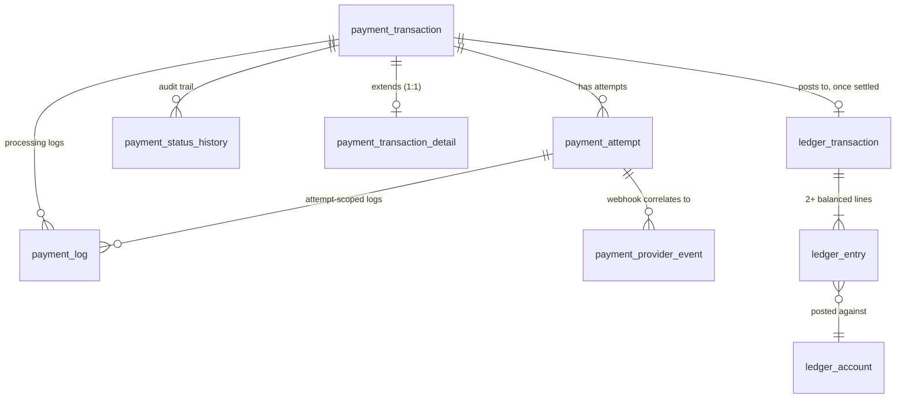
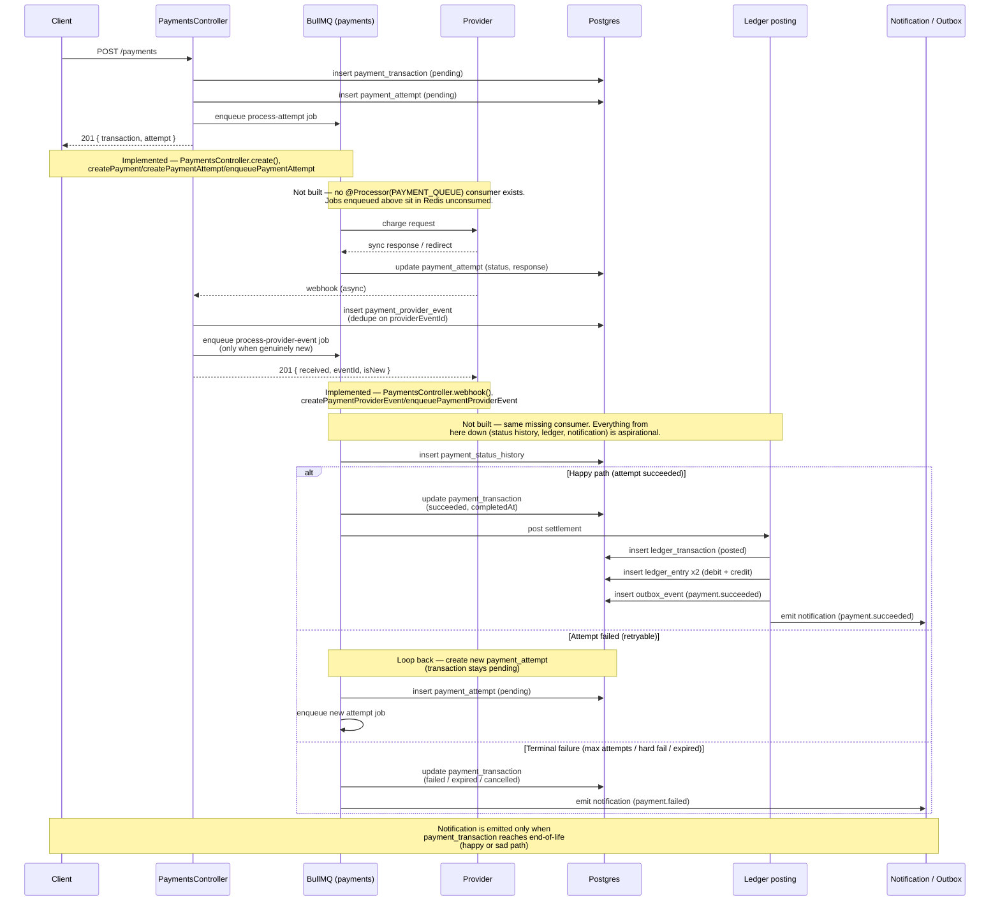

# Payment module

Handles payment processing (talking to a gateway) and posts settled money
movement to an internal double-entry ledger. The two are deliberately kept
as separate table clusters — see [Architecture](#architecture) for why.

## Architecture

### The ledger boundary

A gateway integration is inherently messy: a card gets declined and retried,
a webhook arrives twice, a provider takes eleven seconds and the client
already gave up. That mess needs somewhere to live — it lives in the
**processing layer**. The **ledger** can't be messy: every transaction's
debits must equal its credits, nothing is ever edited in place (only
reversed with a new entry), and the record must read the same regardless of
which gateway or retry path produced it.

So the ledger is a separate cluster that is only written to once a
`payment_transaction` actually reaches a terminal success state — never
while it's still in flight.

| Layer      | Table                         | Purpose                                                                                                                            |
| ---------- | ----------------------------- | ---------------------------------------------------------------------------------------------------------------------------------- |
| Processing | `payment_transactions`        | One row per operation (payment / capture / refund / void). The seam: the only table the API queries directly.                      |
| Processing | `payment_attempts`            | One row per try against a provider. A transaction can have several (declined card, retried method, retried after timeout).         |
| Processing | `payment_status_history`      | Audit trail of every status transition on a transaction, and who/what caused it.                                                   |
| Processing | `payment_provider_events`     | Inbound webhook intake, deduped on `(provider, providerEventId)`. The provider's inbox — mirror image of `outbox_events`.          |
| Processing | `payment_transaction_details` | 1:1 satellite for bulky/sensitive provider payload (masked account, redirect URL, raw response) — keeps the hot table lean.        |
| Processing | `payment_logs`                | Free-form operational/debug trail. Distinct from `payment_status_history`, which only ever records a business-state change.        |
| Ledger     | `ledger_accounts`             | Chart of accounts — what an entry can post against (customer wallets, platform revenue, provider clearing, tax payable).           |
| Ledger     | `ledger_transactions`         | A posted (or reversed) unit of bookkeeping. Created once, when a `payment_transaction` settles.                                    |
| Ledger     | `ledger_entries`              | The debit/credit lines under a `ledger_transaction`; must net to zero per currency — enforced in the service layer, not by the DB. |

Full field-level definitions are in [`entity/`](./entity).

Two more folders round out the module: [`use-cases/`](./use-cases) is the
actual business logic — `Effect.fn`-wrapped generators (create/check/list/
upsert a transaction; create/list an attempt; enqueue a job; create a
provider event) that `yield*` `DbClientTag` (`../db/db.provider.ts`) and
`PaymentQueueTag` (`./queue/payment-queue.provider.ts`) instead of taking a
Drizzle client or a BullMQ `Queue` as a plain parameter, and fail with the
`Schema.TaggedError` classes in `use-cases/errors.ts` instead of throwing.
`PaymentsController` is the only bridge back to NestJS: its `run()` helper
provides both tags' layers from the injected `DRIZZLE`/`@InjectQueue`
instances, runs the effect with `Effect.runPromiseExit`, and maps a typed
failure to an `HttpException` via a `switch` on `error._tag` — an unmodeled
defect falls through to `GlobalExceptionFilter` as a 500. [`providers/`](./providers)
is the gateway abstraction (`PaymentGatewayProvider` interface +
`PaymentGatewayRegistry`, resolving by the plain `provider` string already
on `payment_attempts`) — no concrete bank implementation is registered yet,
so `PAYMENT_GATEWAY_PROVIDERS` is `[]` and the registry would throw if
anything tried to resolve a provider today.

### Entity map

### Where the queue and the outbox fit

- **BullMQ `payments` queue** (`PAYMENT_QUEUE`, defined in
  `payment.constants.ts` — deliberately not `payment.module.ts`, see Open
  items — against the shared Redis connection from `app.module.ts`) is the
  async work queue for gateway calls and webhook handling. The **producer**
  side is real: `PaymentsController.create()` enqueues a
  `process-attempt` job right after inserting the transaction and its first
  attempt, and `POST /payments/webhook` enqueues a `process-provider-event`
  job for every genuinely new event (never for a duplicate). There is
  **no consumer** — no `@Processor(PAYMENT_QUEUE)` class exists, so jobs sit
  in Redis unconsumed. `defaultJobOptions` (attempts + exponential backoff)
  are wired from `PAYMENT_JOB_ATTEMPTS` / `PAYMENT_JOB_BACKOFF_MS`;
  `PAYMENT_WORKER_CONCURRENCY` stays unused until a worker exists to read
  it.
- **The transactional outbox** (`outbox_events`, `src/outbox/`) is how a
  settled payment tells the rest of the system — e.g. an
  `payment.succeeded` / `payment.refunded` event that notifications or other
  modules subscribe to, written in the same DB transaction as the
  `payment_transaction` update. It is not for gateway-facing traffic; that's
  what `payment_provider_events` is for. **Not wired yet** — see
  [Current state](#current-state).
- **Notification emission is end-of-life only, and it's asymmetric with the
  outbox.** On the happy path, settlement writes an `outbox_event` _and_
  emits a notification — the outbox row is the durable "something happened"
  fact other modules can subscribe to later; the notification emit is the
  immediate "tell this user now" side effect. On the terminal-failure path
  there's no ledger posting, so there's no `outbox_event` either — failure
  notifications are emitted directly off the queue. A retryable failure
  (new `payment_attempt`, transaction still `pending`) never notifies; the
  transaction hasn't reached end-of-life yet.

### Balance invariant

Nothing in the schema enforces that a `ledger_transaction`'s entries sum to
zero per currency — a Postgres `CHECK` constraint can't see sibling rows.
This has to be a single service-layer write path that always inserts
debit/credit pairs inside one DB transaction.

## Lifecycle, end to end

Key properties this gives us:

- **Nothing in the ledger cluster is touched until the last step.** Retries,
  duplicate webhooks, and abandoned attempts all play out entirely inside
  the processing layer.
- **A `payment_transaction` never regresses out of a terminal state.** A
  refund or a void is a _new_ `payment_transaction` row (type `refund` /
  `void`), not a mutation of the original `payment` row — so the ledger
  always has one clean posting per operation.
- **Webhook idempotency is structural, not application logic.** The unique
  index on `(provider, providerEventId)` in `payment_provider_events` is
  what makes a duplicated webhook a no-op.
- **A retryable failure is invisible outside the processing layer.** It
  produces a new `payment_attempt` row and nothing else — no status
  history entry beyond the attempt itself, no notification, no ledger
  touch. Only a transition of the `payment_transaction` row itself (to
  `succeeded`, `failed`, `expired`, or `cancelled`) is end-of-life.
- **The notification fires exactly once per transaction, on exactly one of
  two paths.** Success routes through the ledger (outbox row + notify);
  terminal failure notifies directly off the queue, with no ledger or
  outbox involvement — there's nothing to post.

## Current state

| Piece                                        | Status                                                                                                                                                                |
| -------------------------------------------- | --------------------------------------------------------------------------------------------------------------------------------------------------------------------- |
| Entities (`entity/*.ts`)                     | Done — all 9 tables, wired into `src/db/schema/index.ts`, migrated.                                                                                                   |
| Payment transaction lifecycle (`use-cases/`) | Done — create/check/list/upsert on `payment_transactions`, create/list on `payment_attempts`, all Effect-typed, `tsc`/`nest build`-verified.                          |
| `PaymentsController` (REST surface)          | Done — `POST/GET /payments`, `GET /payments/:id`, `GET /payments/:id/attempts`, `PATCH /payments/:id` (admin-only), `POST /payments/webhook` (public).                |
| Webhook intake (dedupe + enqueue)            | Done — `createPaymentProviderEvent` dedupes on `(provider, providerEventId)` via `onConflictDoNothing`; a duplicate never re-enqueues.                                |
| BullMQ `payments` queue — producer           | Done — `process-attempt` enqueued from `create()`, `process-provider-event` enqueued from `webhook()`. `defaultJobOptions` wired from config.                         |
| BullMQ `payments` queue — consumer           | Not started — no `@Processor(PAYMENT_QUEUE)` class; enqueued jobs are never picked up.                                                                                |
| Provider gateway abstraction (`providers/`)  | Scaffolded, unwired — `PaymentGatewayProvider` interface + `PaymentGatewayRegistry` exist; `PAYMENT_GATEWAY_PROVIDERS` is `[]`, no bank implemented.                  |
| Outbox integration (`payment.*` events)      | Not started.                                                                                                                                                          |
| Ledger posting service                       | Not started.                                                                                                                                                          |
| Notification emission (success / failure)    | Not started — no `Notifier`/consumer exists; diagram is the target shape.                                                                                             |
| Automated tests                              | Not started — no unit or e2e tests exist for any use-case, the controller, or the queue producer. Verification so far is `tsc` + `nest build` + one manual boot test. |

## Open items

- `payment_transactions.tenantId` and `.orderId` are plain UUIDs with no FK
  — there's no `tenants` or `orders` table in this codebase yet (see
  [`../tenant/README.md`](../tenant/README.md)). `PaymentsController.create()`
  currently writes a hardcoded `DEFAULT_TENANT_ID` placeholder
  (`00000000-…`) to every transaction — real values only make sense once a
  `tenants` table exists.
- No admin/reporting surface for the ledger (e.g. a trial-balance view) —
  out of scope until the posting service exists.
- **Notification delivery mechanism is undecided.** The lifecycle diagram
  fixes _when_ a notification fires (once, at end-of-life, on either the
  success or terminal-failure path) but not _how_ — whether "Notifier" ends
  up being a consumer of `outbox_events`, a direct call from the queue
  processor, or its own module. The failure path in particular has no
  outbox row to key off, so it can't simply be "subscribe to the outbox."
- **No test coverage anywhere in this module.** Every use-case is a pure
  `Effect.fn` taking its dependencies through `DbClientTag`/`PaymentQueueTag`
  specifically so a fake layer can be swapped in for testing without a real
  Postgres or Redis — that seam has never actually been exercised by a test.
  Confidence today rests on `tsc`, `nest build`, and one manual boot check,
  not on anything that runs the code.
- **Transaction + attempt insert is atomic via `runInTransaction`.** `create()`
  wraps `createPayment` and `createPaymentAttempt` inside `runInTransaction`
  (`../../db/db.provider.ts`), enabled by typing `DbClientTag` against `DbExecutor`
  instead of `DbClient`. A failure during attempt creation rolls back the DB
  transaction, preventing orphaned `payment_transaction` rows, and the job is
  only enqueued to BullMQ once the transaction has committed.
- **A module↔controller circular import previously broke queue injection
  silently.** `PAYMENT_QUEUE` used to live in `payment.module.ts`, which
  `payment.controller.ts` imported while `payment.module.ts` imported the
  controller back — `@InjectQueue(PAYMENT_QUEUE)` evaluated before the
  constant was assigned, silently binding to BullMQ's `"default"` queue
  instead of `"payments"` (no compile error; only visible at boot as
  `UnknownDependenciesException`). Fixed by moving the constant to
  `payment.constants.ts`, a leaf file both sides import — keep any future
  cross-file constant shared between a module and its own controller in a
  leaf file, not in whichever of the two files feels more natural.
- **`CreatePaymentDto.provider` is an unvalidated free string.** There's no
  real gateway registered yet (`PAYMENT_GATEWAY_PROVIDERS` is `[]`), so
  nothing checks the client's `provider` value against
  `PaymentGatewayRegistry` — any string is accepted at creation time and
  would only fail once something actually tries to resolve it.
