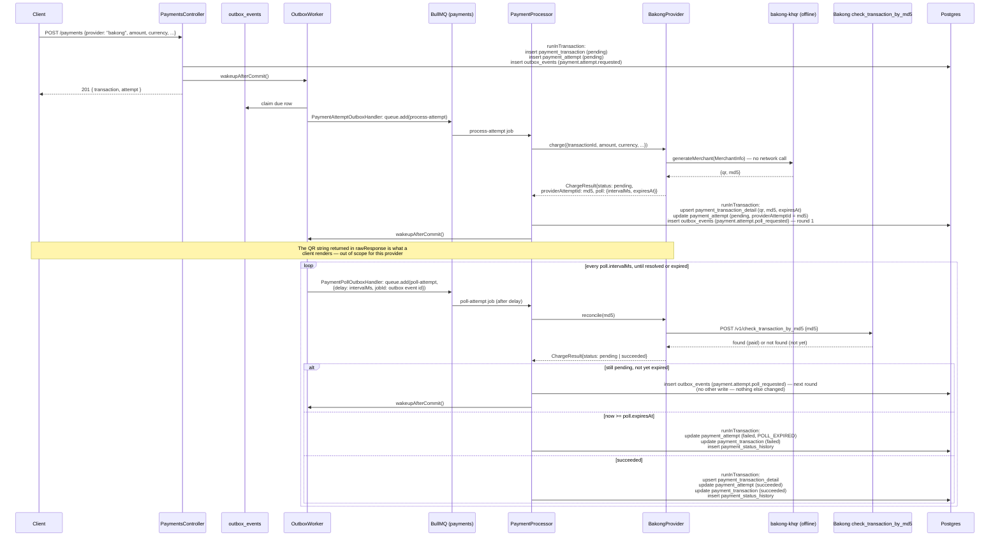

# Bakong (KHQR) provider

Bakong's implementation of the `PaymentGatewayProvider` seam (see
[`../payment-gateway.interface.ts`](../payment-gateway.interface.ts) and the
[payment module README](../../README.md) for the general contract). This is
the one provider in this module that isn't shaped like a normal payment
gateway integration, and that shape mismatch is the whole reason this
directory — and the poll loop it drives in `../../use-cases/` and
`../../processors/` — exists.

## Architecture

### There's no "create transaction" call, and no webhook — polling stands in for both

Every other provider this interface was designed around (ABA PayWay is the
existing example) works the same way: a server-side call creates a checkout
session, and the provider later pushes a webhook when the payer finishes.
Bakong does neither:

- **Generating a KHQR is a local, offline operation.** The `bakong-khqr`
  SDK builds the EMV QR string (and its MD5, which becomes Bakong's only
  handle on the transaction) entirely in-process — no request leaves this
  service to "create" anything. `charge()` therefore always either fails
  synchronously (a KHQR the SDK itself rejects — bad amount, missing
  merchant field) or returns `pending` immediately; there is no "checkout
  session created, awaiting payment" network round trip to fail on.
- **Bakong never calls us back.** There is no webhook, signed or
  otherwise, for a KHQR payment. The only way to learn whether a payer
  scanned and paid is to ask — repeatedly — via
  `POST /v1/check_transaction_by_md5`.

That second point is what makes this provider's `charge()` fundamentally
incomplete on its own: returning `pending` and stopping there (as `charge()`
alone does) would leave the attempt stuck forever, because nothing is ever
going to tell it otherwise unless something keeps asking. `ChargeResult.poll`
(set only by this provider — see
[`../payment-gateway.types.ts`](../payment-gateway.types.ts)) is what closes
that gap: it asks `processPaymentAttempt` to schedule a `reconcile()` poll
loop, which becomes the _only_ path to a resolved status for an attempt
charged through this provider. See [Lifecycle, end to end](#lifecycle-end-to-end)
for the full loop.

### Individual vs merchant accounts

`bakong-khqr` has two KHQR generation entry points, and they need genuinely
different setup, not just different field names:

- **`merchant`** (`MerchantInfo`/`generateMerchant`) needs a registered
  `merchantId` + `acquiringBank` — obtained by onboarding as a merchant
  through a participating bank/PSP. This is real business registration,
  not something either side of this codebase can generate.
- **`individual`** (`IndividualInfo`/`generateIndividual`) needs neither —
  just a personal Bakong account alias (`name@bank`, the one anyone with a
  Bakong-linked bank account already has). No onboarding required.

`BAKONG_MERCHANT_TYPE` (`individual` | `merchant`, defaults to
`individual`) picks which one `BakongProvider` builds
(`BakongAccountConfig` in `bakong.types.ts` — a discriminated union, not
one shape with optional fields, since the two really do need different
inputs). `createBakongTransaction` branches on `account.type` to call the
matching SDK entry point. The default favors `individual` because it's the
zero-setup path — an environment with no merchant credentials at all still
works for KHQR generation; switching to `merchant` is an explicit opt-in
once real merchant credentials exist.

### One file per concern

| File                                     | Purpose                                                                                                                                                                                                                         |
| ---------------------------------------- | ------------------------------------------------------------------------------------------------------------------------------------------------------------------------------------------------------------------------------- |
| `bakong.provider.ts`                     | Implements `PaymentGatewayProvider` — `charge()`, `reconcile()`, `verifyWebhookSignature()`, `parseWebhookEvent()`, `redact()`. The thin Promise boundary; see below.                                                           |
| `bakong.types.ts`                        | `BakongAccountConfig` and the `check_transaction_by_md5` wire types.                                                                                                                                                            |
| `bakong.status.ts`                       | `toPaymentAttemptOutcome` — maps a `check_transaction_by_md5` response onto `payment_attempts.status`.                                                                                                                          |
| `bakong-khqr.d.ts`                       | Ambient type declarations for the `bakong-khqr` SDK, which ships none of its own.                                                                                                                                               |
| `handlers/create-transaction.handler.ts` | `createBakongTransaction` — the create-transaction _action_: builds the KHQR via the SDK. No network call, no error channel (see below).                                                                                        |
| `handlers/check-transaction.handler.ts`  | `checkBakongTransaction` — the check-transaction _action_: the one real network call this provider makes.                                                                                                                       |
| `../../../utils/api-client.ts`           | Shared axios+Effect HTTP client (originally written for this provider, promoted out to `src/utils/` once it became clear any provider making a plain REST call could reuse it — ABA still does its own `fetch()`, unconverted). |

No `Entity map` subsection — this provider owns no database tables; it only
produces rows in tables the module already owns (`payment_attempts`,
`payment_transaction_details`, `outbox_events`).

### Handlers are the actions; the provider is the adapter

`createBakongTransaction`/`checkBakongTransaction` are written as `Effect`s
(`Effect.fn`, matching `../../use-cases/`'s convention), not NestJS-injectable
classes, specifically so they compose the way the rest of this module's
business logic does: typed failures (`ApiClientError` from
`checkBakongTransaction`, nothing at all from `createBakongTransaction` —
see its own doc comment), a free tracing span from `Effect.fn`'s name
argument, and an easy seam to hang retry/timeout combinators on later
without a rewrite.

`PaymentGatewayProvider` itself has to stay Promise-based — both NestJS DI
and the interface contract require it — so `BakongProvider` is the thin
boundary that runs those Effects and adapts their result into
`ChargeResult`/`ParsedProviderEvent`, the same role `PaymentEffectRunner`
plays for the controllers (`Effect.runPromise`, not
`PaymentEffectRunner` itself, since this runs from inside a plain
`PaymentGatewayProvider` method rather than a controller action).

### Where the queue and the outbox fit — a provider-owned addition

The payment module README already describes the outbox↔BullMQ split in
general terms; this provider is what pushed it to a third job kind and a
third outbox event type, because ABA's webhook-driven model has no polling
concept to reuse:

- **`processPaymentAttempt`** (shared, `../../use-cases/`) is unchanged in
  shape but gained one new branch: when `charge()`'s result carries
  `poll`, it writes a `payment.attempt.poll_requested` outbox row —
  `enqueuePaymentAttemptPoll` — inside the _same_ transaction as the
  attempt's own pending-status write. This is the one genuinely durability-sensitive
  moment in the whole loop: if the process died between committing "attempt
  is pending" and scheduling the first poll, nothing would ever check this
  attempt again. Same commit-then-enqueue guarantee the rest of the module
  relies on.
- **`pollPaymentAttempt`** (new, `../../use-cases/poll-payment-attempt.use-case.ts`)
  is the loop body: call `reconcile()`, and either apply a definite outcome
  (`succeeded`/`failed`) the same way `processPaymentAttempt` does, give up
  as `failed` (`POLL_EXPIRED`) once `poll.expiresAt` has passed, or — on
  `pending` — call `enqueuePaymentAttemptPoll` again for the next round.
  That last branch **deliberately doesn't wrap the outbox write in
  `runInTransaction`**: nothing else changes in the database on a
  "still nothing to report" round, so there's nothing for the insert to be
  atomic with. If the process dies right after that insert commits, the row
  is exactly as durable as any other outbox row — BullMQ/the outbox's own
  crash recovery covers it from there.
- **`PaymentPollOutboxHandler`** (new, `../../outbox/payment-poll-outbox-handler.ts`)
  is what turns a `payment.attempt.poll_requested` row into a BullMQ
  `poll-attempt` job — the _only_ one of the three outbox handlers in this
  module that passes a `delay` (`payload.intervalMs`) to `queue.add()`. The
  outbox row itself is dispatched as soon as a worker claims it; the delay
  lives on the BullMQ job, not on when the outbox considers the row "due".
  Its `jobId` is the outbox event's own id, not the attempt id — contrast
  `PaymentAttemptOutboxHandler`, whose fixed `jobId: paymentAttemptId` is a
  one-shot dedupe key. A poll attempt legitimately produces many jobs over
  one attempt's lifetime, so a fixed attempt-scoped jobId would collide
  across rounds instead of deduping a retry of the _same_ round.
- **No `dedupeKey`** on the poll outbox event (contrast the other two event
  types, which key on `paymentAttemptId`/`paymentProviderEventId`) — every
  call to `enqueuePaymentAttemptPoll` is meant to produce a fresh row, not
  collapse into an earlier one. Postgres unique indexes ignore `NULL`, so an
  omitted `dedupeKey` never collides with anything (see
  `OutboxService.enqueue`'s own doc comment).

## Lifecycle, end to end

Key properties this gives us:

- **No webhook route exists for this provider, on purpose.**
  `verifyWebhookSignature()` always returns `{valid: false}` and
  `parseWebhookEvent()` throws if it's ever reached — there's no signature
  to check and no payload shape to parse, because Bakong never sends
  either. This is an honest model of "no channel exists", not a stub
  standing in for one that should.
- **The one durability-critical moment — going from "charging" to
  "polling" — is atomic.** The first `payment.attempt.poll_requested` row
  commits in the same transaction as the attempt's own pending-status
  write. Every subsequent round only ever writes when nothing else changed,
  so there's no multi-write atomicity to lose there.
- **A pending attempt cannot poll forever.** `poll.expiresAt` (mirroring
  the KHQR's own `expirationTimestamp`) is what a stuck-forever attempt
  would otherwise become without a comparison — it degrades to a normal
  `failed` transition (`POLL_EXPIRED`) instead of an eternal BullMQ job or
  an eternally `pending` transaction.
- **Every poll round is visible in `outbox_events`.** An operator can see
  exactly how many times, and how recently, a given attempt has been
  checked — for free, since each round is a real (if short-lived) database
  row rather than in-memory scheduler state.
- **`reconcile()` is primary here, not a fallback.** Contrast ABA, where
  `reconcile()` only ever corroborates an already-received webhook — for
  Bakong it's the sole source of truth, which is why it's driven by its own
  dedicated loop instead of `processProviderEvent`.

## Configuration

| Var                        | Required for                                                                                                                                                                       |
| -------------------------- | ---------------------------------------------------------------------------------------------------------------------------------------------------------------------------------- |
| `BAKONG_MERCHANT_TYPE`     | Picks `individual` or `merchant` KHQR generation — see [Individual vs merchant accounts](#individual-vs-merchant-accounts). Defaults to `individual`.                              |
| `BAKONG_ACCOUNT_ID`        | Every `charge()` call, both account types — the Bakong account alias (`name@bank`) KHQR is generated against.                                                                      |
| `BAKONG_MERCHANT_NAME`     | Every `charge()` call, both account types — the display name on the KHQR (a person's name for `individual`, a business name for `merchant`).                                       |
| `BAKONG_MERCHANT_CITY`     | Every `charge()` call, both account types. Defaults to `Phnom Penh`.                                                                                                               |
| `BAKONG_MERCHANT_ID`       | Only when `BAKONG_MERCHANT_TYPE=merchant`.                                                                                                                                         |
| `BAKONG_ACQUIRING_BANK`    | Only when `BAKONG_MERCHANT_TYPE=merchant`.                                                                                                                                         |
| `BAKONG_QR_EXPIRY_SECONDS` | How long a generated KHQR stays valid — becomes `poll.expiresAt`. Defaults to `300` (5 minutes).                                                                                   |
| `BAKONG_API_KEY`           | The only network call this provider makes: `reconcile()` → `check_transaction_by_md5`. A bearer token, not a signing key — nothing here is HMAC-signed the way ABA's requests are. |
| `BAKONG_BASE_URL`          | Defaults to `https://api-bakong.nbc.gov.kh`.                                                                                                                                       |
| `BAKONG_POLL_INTERVAL_MS`  | Delay between `poll-attempt` jobs. Defaults to `4000`.                                                                                                                             |

All are optional at the `ConfigModule` level so the app can boot without
Bakong credentials, but `charge()` throws immediately if `BAKONG_ACCOUNT_ID`
or `BAKONG_MERCHANT_NAME` is unset, and additionally if
`BAKONG_MERCHANT_ID`/`BAKONG_ACQUIRING_BANK` are unset while
`BAKONG_MERCHANT_TYPE=merchant`; `reconcile()` throws immediately if
`BAKONG_API_KEY` is unset. A misconfigured environment fails the first time
it's actually used, with a clear message, rather than sending Bakong a
malformed request. Note the split: an environment can be fully configured
for KHQR generation (`charge()` works) while still failing every poll
(`reconcile()` doesn't) if only `BAKONG_API_KEY` is missing — the two
failure points are independent and it's worth checking both when Bakong
"isn't working".

## Current state

| Piece                                              | Status                                                                                                                                                                                                                                                                                                                             |
| -------------------------------------------------- | ---------------------------------------------------------------------------------------------------------------------------------------------------------------------------------------------------------------------------------------------------------------------------------------------------------------------------------- |
| `charge()` (KHQR generation)                       | Done — fully offline via `bakong-khqr`'s `generateMerchant()`/`generateIndividual()` (`BAKONG_MERCHANT_TYPE`-selected). Always dynamic (carries an amount), so always sets `expirationTimestamp`/`poll.expiresAt`.                                                                                                                 |
| `reconcile()` (`check_transaction_by_md5`)         | Done, against the production Bakong Open API base URL by default.                                                                                                                                                                                                                                                                  |
| Poll loop (`pollPaymentAttempt` + friends)         | Done — schedules itself on `pending`, terminates on `succeeded`/`failed`/expiry. See [Lifecycle](#lifecycle-end-to-end).                                                                                                                                                                                                           |
| `verifyWebhookSignature()` / `parseWebhookEvent()` | Deliberately always-invalid / throwing — no webhook channel exists for this provider (see [Architecture](#architecture)), not an unimplemented stub.                                                                                                                                                                               |
| `redact()`                                         | Identity function — `check_transaction_by_md5`'s documented fields (`fromAccountId`/`toAccountId` are account _aliases_, not raw numbers) carry nothing that looks like a secret, but this hasn't been checked against a real response (see [Open items](#open-items)).                                                            |
| `util/api-client.ts` security hardening            | Baseline only: HTTPS-only base URL enforced, AxiosError sanitized before it becomes `ApiClientError.cause` (so a bearer token can never leak through a logged failure). Response schema validation, retry/backoff, host allowlisting, mTLS, and request signing are explicit `TODO(security)`s in that file, not silently skipped. |
| Unit tests                                         | None yet for this provider — no `*.spec.ts` files exist under this directory (contrast ABA's signing/encoding/status coverage).                                                                                                                                                                                                    |
| Live verification                                  | None — no live Bakong sandbox credentials, and no real `check_transaction_by_md5` call, have been exercised in this environment. Verification is `tsc`/`nest build`/`pnpm test` (272 passing, no regressions) only.                                                                                                                |

## Open items

- **`check_transaction_by_md5`'s field names are doc-derived, not
  independently verified.** `bakong.types.ts`'s `CheckTransactionByMd5*`
  interfaces come from NBC's publicly published Bakong Open API
  documentation — the same class of caveat as ABA's unverified hash field
  order (see `../aba-payway/README.md`'s Open items). If a live call comes
  back with different field names or a different `responseCode` convention
  than assumed, `bakong.status.ts`'s `toPaymentAttemptOutcome` is the first
  place to recheck.
- **No test coverage at all for this provider or the poll loop it drives.**
  Neither this directory's handlers/provider nor
  `poll-payment-attempt.use-case.ts` / `enqueue-payment-attempt-poll.use-case.ts`
  / `PaymentPollOutboxHandler` have unit tests — this mirrors the
  module-wide gap the main README already flags for `processPaymentAttempt`
  etc., just extended to the new pieces.
- **Deeplink generation isn't wired.** `bakong-khqr` can turn a KHQR string
  into an app-openable shortlink (`BakongKHQR.generateDeepLink`), which
  would be the natural value for `ChargeResult.redirectUrl` (the field
  ABA's `checkout_qr_url` fills). This provider currently leaves
  `redirectUrl` unset and returns only the raw `qr`/`md5` in `rawResponse`
  — a client has to render the QR itself. Deliberate scope cut, not an
  oversight — `generateDeepLink` needs its own NBC-hosted shortlink
  endpoint plus source-app metadata (`SourceInfo`) this codebase has no
  config for yet.
- **Poll-round outbox volume scales with `1 / BAKONG_POLL_INTERVAL_MS`.** At
  the default 4s interval and 5-minute KHQR expiry, one attempt produces up
  to ~75 `payment.attempt.poll_requested` rows before settling or expiring.
  Each is cheap and short-lived (deleted `OUTBOX_RETENTION_DAYS` after
  publishing by the hourly `OutboxRetention` sweep,
  `src/outbox/outbox-retention.service.ts`), but a much
  shorter interval or much higher payment volume would be worth revisiting
  against real load before assuming it's free.
- **No admin/operator visibility into "how many attempts are currently
  polling" beyond querying `outbox_events`/`payment_attempts` directly** —
  there's no dashboard or metric surfacing poll-loop health specifically.
- **`api-client.ts`'s `TODO(security)` list applies here in full** — see
  that file directly. The most load-bearing gap for this specific provider
  is the missing response schema validation: `reconcile()` currently trusts
  whatever shape `check_transaction_by_md5` returns without decoding it
  against `CheckTransactionByMd5Response`.
