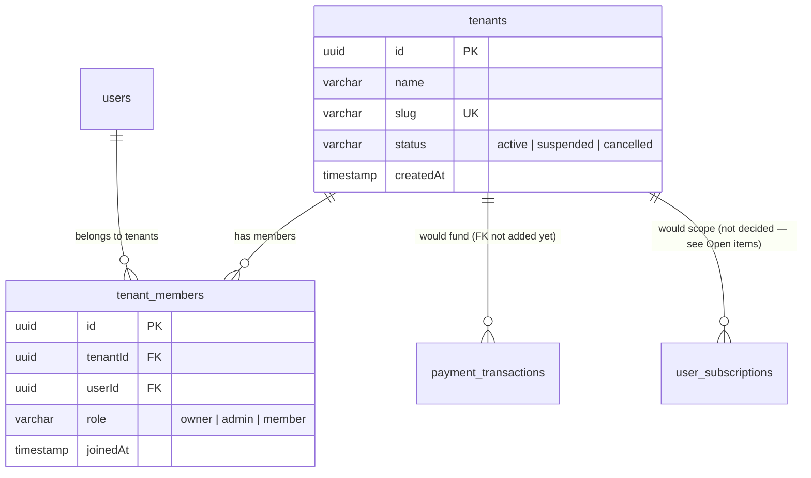

# Tenant module (proposed — not implemented)

There is no code under `src/tenant/` yet, and none is being added by this
document. This is a design sketch, written to fix the _shape_ of a future
multi-tenant/organization layer before any table exists, so
`payment_transactions.tenantId` (already a bare, FK-less UUID — see the
payment module's Open items) has a concrete target it could eventually
point at. Nothing here is wired: no schema file, no migration, no
`src/db/schema/index.ts` export, no code touching `users`, `payment`, or
`subscriptions`.

## Why this exists now

The direction is a SaaS product with organization-level billing, not just
individual marketplace accounts. Building that properly means deciding how
tenancy applies everywhere — users, listings, categories, every row that
would eventually need to be scoped to an organization — which is a much
bigger change than payment or subscriptions can decide on their own. This
document exists so that decision can be discussed and referenced without
blocking or risking the payment work happening in parallel.

## Proposed architecture

### A tenant is an organization users belong to, not a replacement for the user

The core idea: today's `users` table stays exactly as it is — individual
marketplace accounts, untouched. A `tenants` table would represent an
organization/account that some subset of users belong to, via a
`tenant_members` join table carrying a role. This is additive by
construction: a user with zero tenant memberships behaves exactly as every
user does today.

| Table (proposed) | Purpose                                                                                        |
| ---------------- | ---------------------------------------------------------------------------------------------- |
| `tenants`        | One row per organization. Owns the billing identity — name, slug, status.                      |
| `tenant_members` | Join table: which users belong to which tenant, and their role in it (owner / admin / member). |

### Proposed entity map

### Where this would touch the two existing billing surfaces

- **`payment_transactions.tenantId`** is already a plain UUID column with
  no FK, specifically because no `tenants` table exists (see
  [`../payment/README.md`](../payment/README.md)'s Open items). Once
  `tenants` is real, pointing that column at it is a safe, additive
  migration — the column doesn't need to change shape, only gain a
  constraint.
- **`user_subscriptions`** (see
  [`../admin/subscriptions/README.md`](../admin/subscriptions/README.md))
  is user-scoped today, not tenant-scoped. Making a subscription apply to
  a whole organization (one plan, many seats) is a real design fork: add
  a nullable `tenantId` alongside the existing `userId`, or introduce a
  parallel `tenant_subscriptions` table. This document doesn't resolve
  that — it's the open question a real tenant design pass needs to
  answer first.

## Current state

| Piece                                                           | Status                                                                          |
| --------------------------------------------------------------- | ------------------------------------------------------------------------------- |
| `tenants` / `tenant_members` tables                             | Not started — no schema file, no migration. This document is the only artifact. |
| `payment_transactions.tenantId` → real FK                       | Not started — the column exists (nullable, bare UUID) but references nothing.   |
| Tenant-scoped subscriptions                                     | Not started — not even decided whether it's a new column or a new table.        |
| Row-level tenant scoping elsewhere (listings, categories, etc.) | Not started — explicitly out of scope for this document; its own design pass.   |

## Open items

- **"Organization owning marketplace users" vs. "separate B2B surface"
  is undecided**, and changes nearly everything downstream. This document
  assumes the former (additive, users unchanged) because it's the
  lower-risk shape, not because it's confirmed as the direction.
- **`user_subscriptions` vs. a new tenant-level subscriptions table** is a
  prerequisite decision for actually wiring payment → subscription →
  tenant together — deferred here on purpose.
- **This file has no matching code.** Treat it as a proposal, not
  documentation of something built. Once real entity files land under
  `src/tenant/entity/`, this README should be rewritten against the
  Module README convention in the root `CLAUDE.md` like every other real
  module — read the files, verify claims against the code, don't just
  carry this draft forward.
