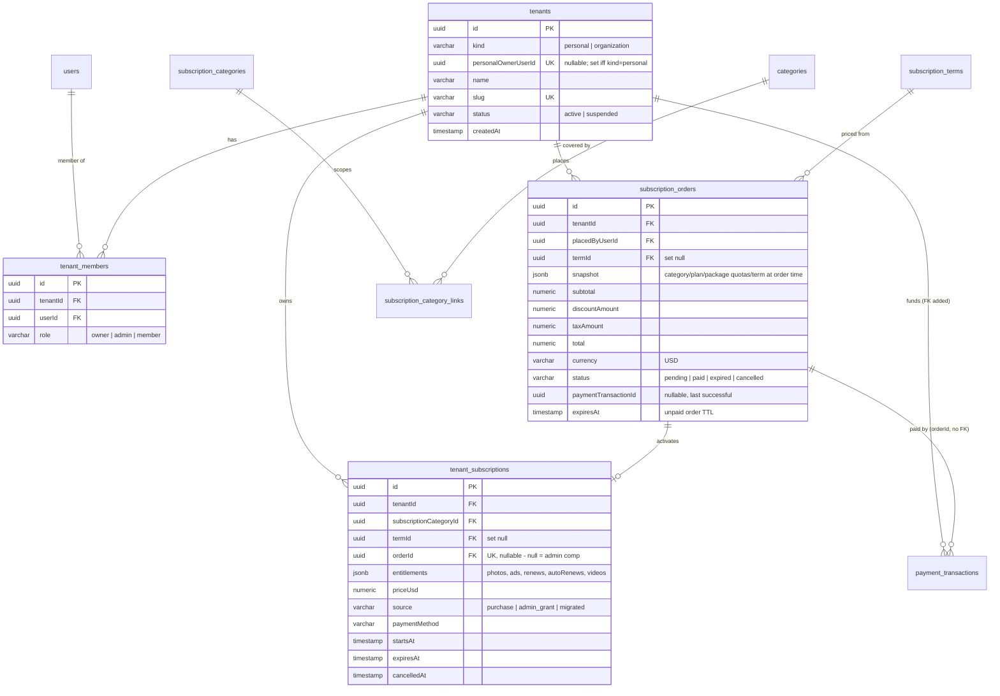

# Plan — tenant subscriptions (self-serve, paid through the payment module)

Written 2026-09-29. Status: **plan only — nothing built.** Supersedes the
"not decided" fork in `apps/backend/src/tenant/README.md`.

Goal: a user (and later an organization) picks a premium plan on the web,
pays through the existing payment module (ABA PayWay / Bakong), and the
subscription activates automatically, with its package limits (ads, photos,
renews, …) actually enforced. Admin comp grants keep working.

---

## 1. What exists today (schema audit)

Read before designing — every decision below is constrained by these.

| Area                                            | What is built                                                                                                                                                                                                                                                                           | Consequence for this plan                                                                                                                                                                                   |
| ----------------------------------------------- | --------------------------------------------------------------------------------------------------------------------------------------------------------------------------------------------------------------------------------------------------------------------------------------- | ----------------------------------------------------------------------------------------------------------------------------------------------------------------------------------------------------------- |
| `users` (`db/schema/users.schema.ts`)           | Individual accounts, soft-delete, `role` user/admin/super_admin. No org concept.                                                                                                                                                                                                        | Keep untouched. Tenancy is **additive**.                                                                                                                                                                    |
| Subscription config (`subscriptions.schema.ts`) | 4 tiers: `subscription_categories → plans → packages → terms`. Packages carry integer quotas (`photos, ads, renews, autoRenews, videos`). Terms carry `price numeric(10,2)` + `discount/discountType` + `durationValue/Unit`. Admin CRUD done.                                          | Catalogue is reusable as-is. **No link** from `subscription_categories` (Auto / Food / General / Property / Services…) to listing `categories` — quotas cannot be scoped to listings yet.                   |
| `user_subscriptions`                            | `userId` FK cascade, `termId` FK set null, `priceUsd` snapshot, `paymentMethod` **free text**, `subscribedAt/expiresAt`. Status derived (`expiresAt > now`). Only writer: admin `POST /admin/user-subscriptions`. Readers: `UserSubscriptionsService`, `AdminService` premium `EXISTS`. | User-scoped, no payment FK, no package/plan snapshot (a deleted term loses what was bought).                                                                                                                |
| `payment.payment_transactions`                  | `tenantId uuid NOT NULL` **no FK**; controller writes `DEFAULT_TENANT_ID = 00000000-…` on every row. `orderId uuid` no FK, "loose pointer to a subscription term, a listing boost…". `customerId → users`.                                                                              | The payment module already expects a tenant + an order. We supply both instead of inventing a parallel path.                                                                                                |
| Payment settlement                              | Success → ledger posting + outbox `payment.succeeded` (payload has `tenantId, orderId, customerId, amount, currency`), dedupe `payment-succeeded:<txId>`. Consumer: `PaymentSettledOutboxHandler` → in-app notification.                                                                | Activation hook point exists. **But `OutboxRegistry` allows exactly one handler per event type** (throws on a second) — the subscription module cannot just register another `payment.succeeded` handler.   |
| `POST /payments`                                | Client supplies `amount`, `currency`, `orderId`.                                                                                                                                                                                                                                        | A client could pay $0.01 against a subscription order id. Activation must **re-verify amount/currency/customer against the order snapshot**, and subscription checkout must create the payment server-side. |
| `src/tenant/README.md`                          | Proposal only: `tenants(name, slug, status)` + `tenant_members(role owner/admin/member)`. No code.                                                                                                                                                                                      | Adopt its shape, extend it (personal tenants).                                                                                                                                                              |
| Web                                             | `(subscriptions)/premium-account`, `premium-account/[category]`, `checkout` (fully commented out), `/me/subscriptions`, `lib/Subscriptions.ts` — **all mock**. Mock checkout adds 10 % VAT. Admin subscription pages are real.                                                          | Web work is wiring existing designs to real data, not new design.                                                                                                                                           |
| Listings                                        | No quota enforcement; `photos` hard-capped `@ArrayMaxSize(8)`.                                                                                                                                                                                                                          | Entitlements are a new concern.                                                                                                                                                                             |

---

## 2. Core design decision — "account = tenant"

**Recommendation: every paying subject is a tenant. Each user gets a
_personal tenant_ lazily; organizations are just tenants with >1 member.**
(Same model as GitHub/Stripe personal vs. org accounts.)

Why (max 5):

- `payment_transactions.tenantId` is `NOT NULL` — a personal tenant gives
  every payment a real value today and kills `DEFAULT_TENANT_ID`, with no
  change to the payment table's shape (only an FK added).
- One subscription table keyed by `tenantId` — no `userId`-or-`tenantId`
  dual ownership, no two sources of truth for "is premium".
- Org billing later = add members to a tenant; zero schema change.
- `users` stays untouched; a user with no tenant behaves exactly as today.
- Lazy creation avoids touching the 4 registration chokepoints
  (`verifyPhoneOtp`, `mirrorSupabaseUser`, Telegram, admin create).

Rejected alternatives:

| Option                                                           | Why not                                                                                                                  |
| ---------------------------------------------------------------- | ------------------------------------------------------------------------------------------------------------------------ |
| Add nullable `tenantId` next to `userId` on `user_subscriptions` | Two owner columns + CHECK "exactly one"; every reader branches; premium derivation has two paths forever.                |
| Parallel `tenant_subscriptions` table, keep `user_subscriptions` | Two tables mean the same thing; admin grants and paid subs diverge.                                                      |
| Skip tenants, keep user-only                                     | Leaves the payment placeholder forever; org billing (the stated direction in the tenant README) becomes a rewrite later. |

---

## 3. Target data model

New Postgres schema `billing`? **No** — keep `public`, like
`subscriptions.schema.ts`. (Payment/chat got their own schemas because they
are large self-contained clusters; this is 4 tables. Revisit if it grows.)



Rules:

- `tenant_members` unique `(tenantId, userId)`; FK `userId` cascade,
  `tenantId` cascade.
- `tenants.personalOwnerUserId` **unique** → `ensurePersonalTenant(userId)`
  is an `INSERT … ON CONFLICT (personal_owner_user_id) DO NOTHING RETURNING`
  - fallback select. Race-safe, no check-then-insert (avoid the
    `generateUniqueUsername` 23505 trap).
- `tenants` → **`ON DELETE RESTRICT`** from payments/subscriptions (money
  history must never cascade away; ledger already follows this rule).
- `tenant_subscriptions.orderId` **unique** → activation idempotent by
  construction.
- `entitlements` JSONB is a **snapshot** of the package at purchase — an
  admin editing a package later never changes what a customer bought.
- Status stays **derived** (`startsAt <= now < expiresAt and cancelledAt is
null`), matching today's `user_subscriptions` convention.
- One active subscription **per (tenant, subscription category)**. Buying
  the same category again **extends** (`startsAt = max(now, current
expiresAt)`); different categories coexist (Auto + Property).
- `subscription_category_links(subscriptionCategoryId, categoryId)` maps
  "Auto" → cars-and-vehicles etc. Needed for entitlement scoping.
- `payment_transactions`: add FK `tenant_id → tenants.id` (RESTRICT) **after**
  backfilling a "platform" tenant for the existing placeholder rows.

---

## 4. Checkout → activation flow

```mermaid
sequenceDiagram
    participant W as Web (/premium-account → /checkout)
    participant S as SubscriptionsController
    participant P as PaymentsFacade (payment module)
    participant Q as Outbox + BullMQ (existing)
    participant H as PaymentSettledOutboxHandler
    participant L as SubscriptionSettlementListener

    W->>S: POST /subscriptions/checkout {termId, provider, method}
    S->>S: ensurePersonalTenant(user)
    S->>S: tx: price term server-side, INSERT subscription_orders(pending, snapshot)
    S->>P: createPayment({tenantId, orderId, customerId, amount=order.total, currency})
    P-->>S: paymentTransaction (pending)
    S-->>W: {orderId, paymentId}
    W->>W: poll GET /payments/:id → checkout.qr/redirect
    Q->>H: payment.succeeded (tenantId, orderId, amount…)
    H->>L: onSettled(payload)  [listener port, see §5]
    L->>L: tx: lock order FOR UPDATE; verify amount/currency/customer/status
    L->>L: INSERT tenant_subscriptions ON CONFLICT(orderId) DO NOTHING; order→paid
    H->>H: in-app notification (existing)
    W->>S: GET /subscriptions/me → active
```

Key properties:

- **Price is never client input.** Checkout computes `total` from the term
  (+ discount, + VAT if decided) and creates the payment in-process. The
  public `POST /payments` path cannot activate a subscription: the listener
  rejects any settled payment whose amount/currency/customer ≠ the order
  snapshot (log + flag for admin, no activation).
- **Exactly-once activation**: outbox dedupe on the event + unique
  `tenant_subscriptions.orderId` + `SELECT … FOR UPDATE` on the order row.
- **Extension math under lock**: compute `startsAt` while holding a lock on
  the tenant's current subscription in that category (or the tenant row) —
  two concurrent purchases must not both start at `now`.
- Unpaid orders expire (`expiresAt`, e.g. 30 min, match Bakong poll TTL);
  a late payment on an expired order still activates (money received wins)
  but is logged.

---

## 5. Module boundaries

| Module                                  | Owns                                                                                                                                            | Must not                                                                                                |
| --------------------------------------- | ----------------------------------------------------------------------------------------------------------------------------------------------- | ------------------------------------------------------------------------------------------------------- |
| `src/tenant/` (new, real)               | `tenants`, `tenant_members`, `TenantService.ensurePersonalTenant`, `resolveBillingTenant(userId)`                                               | Know about payments or plans.                                                                           |
| `src/subscriptions/` (new, user-facing) | `subscription_orders`, `tenant_subscriptions`, checkout, activation listener, entitlements query (`EntitlementsService`), public catalogue read | Touch payment tables directly; use `effect`. Plain NestJS services (Effect stays unique to `payment/`). |
| `src/admin/subscriptions/` (existing)   | Config CRUD (unchanged), grants → rewritten to write `tenant_subscriptions` with `source='admin_grant'`                                         | —                                                                                                       |
| `src/payment/` (existing)               | Gains 2 small seams only (below)                                                                                                                | Import subscriptions.                                                                                   |

Two payment seams (smallest diffs that keep payment gateway-agnostic):

1. **`PaymentsFacade`** — exported plain service wrapping the existing
   `runInTransaction(createPayment + createPaymentAttempt +
enqueuePaymentAttempt)` that `PaymentsController.create` already does, so
   another module can create a payment without importing Effect. Controller
   then delegates to it (one code path).
2. **`PAYMENT_SETTLEMENT_LISTENERS`** — a multi-provider token (same pattern
   as `NOTIFICATION_CHANNELS`). `PaymentSettledOutboxHandler` calls every
   listener before notifying; a listener that throws → handler returns
   `retry`. Listeners must be idempotent (activation is). Subscriptions
   registers one; it no-ops when `orderId` is not a `subscription_orders` id.

Why not a second outbox handler: `OutboxRegistry` is 1 handler / event
type by design. Why not let payment enqueue `subscription.*` events: points
the dependency the wrong way. Optional later: add `orderType` column to
`payment_transactions` so listeners filter without a lookup.

---

## 6. Phases

Each phase shippable alone; each ends with `pnpm --filter backend test`,
`build`, and a `tasks/todo.md` entry.

### Phase 0 — decisions (blockers, answer before coding)

See §8. Minimum to unblock Phase 1: D1, D2.

### Phase 1 — tenancy foundation (backend only, no behaviour change)

- [ ] `src/tenant/entity` or `db/schema/tenants.schema.ts` (+ index export):
      `tenants`, `tenant_members`, enums.
- [ ] Migration `0031`: tables; insert one `kind='organization'`
      "platform" tenant with id `00000000-…` (the current placeholder) so
      existing `payment_transactions` rows become valid; then add FK
      `payment_transactions.tenant_id → tenants.id` RESTRICT.
      **Check journal `when` > DB newest** (known `db:migrate` skip gotcha).
- [ ] `TenantService.ensurePersonalTenant(userId)` (upsert, unit-tested for
      the race) + `resolveBillingTenant(userId)` (personal for now).
- [ ] `PaymentsController.create` writes the caller's personal tenant
      instead of `DEFAULT_TENANT_ID`.
- [ ] Rewrite `src/tenant/README.md` per the Module README convention.

### Phase 2 — subscription ownership moves to tenants

- [ ] Schema: `subscription_orders`, `tenant_subscriptions`,
      `subscription_category_links`.
- [ ] Migration `0032`: for each `user_subscriptions` row → ensure personal
      tenant → insert `tenant_subscriptions(source='migrated',
entitlements from current package)`. Keep `user_subscriptions` table
      **read-only** one release, then drop (`0033`).
- [ ] Admin grant/list/delete (`UserSubscriptionsService`) and
      `AdminService` premium `EXISTS` read `tenant_subscriptions` via
      member → tenant join. Response shapes unchanged → web admin untouched.
- [ ] Seed `subscription_category_links` (Auto→cars-and-vehicles, Property→
      home-and-land, Food→foods, General→phones/computers/electronics/
      furniture/fashion, Services→services, Jobs? — confirm D5).

### Phase 3 — self-serve checkout + activation

- [ ] Payment seams: `PaymentsFacade`, `PAYMENT_SETTLEMENT_LISTENERS`
      (+ unit test: listener throw → `retry`).
- [ ] Public `GET /subscriptions/catalogue` (`@Public`, active rows only,
      nested category→plan→package→term) — replaces `lib/Subscriptions.ts`.
- [ ] `POST /subscriptions/checkout {termId, provider, method,
browserReturnUrl?}` → order + payment. Throttled, idempotency-key
      honoured (existing middleware).
- [ ] `GET /subscriptions/me` (active + history), `GET
/subscriptions/orders/:id` (owner only, 404 otherwise).
- [ ] `SubscriptionSettlementListener` with verification + idempotent
      activation + extension math. Unit tests: happy path, replay, amount
      mismatch, expired order, concurrent double purchase.
- [ ] Order-expiry: hourly BullMQ repeatable job (reuse queue infra, like
      `chat-maintenance`) marks stale `pending` orders `expired`.

### Phase 4 — web

- [ ] `premium-account` + `[category]` pages read the real catalogue.
- [ ] Un-comment/rebuild `checkout` page: order summary from server, method
      picker (KHQR/ABA), calls `checkout` server action, then polls
      `GET /payments/:id` for the QR/redirect and final status (same
      pattern the payment module expects).
- [ ] `/me/subscriptions` + `MyProfileHeader` premium badge from
      `GET /subscriptions/me`.
- [ ] i18n keys in all 6 `messages/*.json`.
- [ ] Browser-verify with Bakong/ABA sandbox (or dev-simulated settle via
      admin `PATCH /payments/:id` if no sandbox reachable).

### Phase 5 — entitlements enforcement

- [ ] `EntitlementsService.for(userId, categoryId)` → sums active
      subscriptions of the user's billing tenant whose
      `subscription_category_links` cover that listing category, plus the
      **free baseline** (D4).
- [ ] Enforce on `POST /listings/:id/publish` (active-ads quota — count
      under a lock / serializable check, not read-then-write) and photo
      count on create/update (replace flat `ArrayMaxSize(8)` ceiling with
      entitlement, keep 8 as hard max until D6).
- [ ] Error code `SUBSCRIPTION_QUOTA_EXCEEDED` (403) + web upsell link.

### Phase 6 — later (explicitly not now)

- Auto-renew (`autoRenews` quota + stored payment tokens — ABA/Bakong
  support TBD), refunds (needs payment `refund` type, not built), org
  tenants UI (invite members, switch billing tenant), invoices/receipts PDF,
  failure notification (payment failure path has no producer yet).

---

## 7. Risks

| Risk                                                                    | Mitigation                                                                                                                                                                                                     |
| ----------------------------------------------------------------------- | -------------------------------------------------------------------------------------------------------------------------------------------------------------------------------------------------------------- |
| Activation driven by a client-created cheap payment                     | Server-side pricing + listener verifies amount/currency/customer vs order snapshot.                                                                                                                            |
| Double activation / double extension under retries or concurrent buys   | Unique `orderId`, `FOR UPDATE` on order + current sub, outbox dedupe.                                                                                                                                          |
| Migrating `user_subscriptions` breaks admin pages / premium stats       | Keep response shapes; old table read-only for one release; compare counts pre/post in migration log.                                                                                                           |
| Adding FK to `payment_transactions.tenant_id` fails on placeholder rows | Insert placeholder-id platform tenant in the same migration, before the FK.                                                                                                                                    |
| Listener retry re-sends the payment notification                        | Handler retries the whole event, so notify may run twice. Run listeners first, notify last; verify `NotificationsService.notify` idempotency (unverified) and add a dedupe key if it isn't. Decide in Phase 3. |
| Quota check race at publish                                             | Count + insert inside one tx with advisory lock per tenant (`pg_advisory_xact_lock(hashtext(tenantId))`).                                                                                                      |
| `db:migrate` silently skipping older-stamped files                      | Verify `__drizzle_migrations` after each migrate.                                                                                                                                                              |

---

## 8. Open decisions (need captain)

| #   | Question                                                                                                                          | Recommendation                                                                                  |
| --- | --------------------------------------------------------------------------------------------------------------------------------- | ----------------------------------------------------------------------------------------------- |
| D1  | Is "tenant" = organization/shop, or just "the paying account"?                                                                    | Both via `kind`; ship personal only now.                                                        |
| D2  | Personal tenant created lazily (on first checkout/grant) or eagerly for every user?                                               | Lazy + backfill only for users with subscriptions.                                              |
| D3  | VAT 10 % on top (mock checkout shows it) or prices tax-inclusive?                                                                 | Store `taxAmount` either way; ask finance. Ledger needs a `tax_payable` split if VAT is on top. |
| D4  | Free (non-premium) baseline: how many active ads / photos per category?                                                           | Needed before Phase 5; config table or env, not hardcoded.                                      |
| D5  | Exact mapping of the mock subscription categories (Auto/Food/General/Property/Services/…) to listing categories; Jobs/Pets/Books? | Captain supplies list → seed.                                                                   |
| D6  | Buying a second plan in the same category: extend, upgrade (prorate), or block?                                                   | Extend if same package; block different package until upgrade logic exists.                     |
| D7  | Currency: USD only, or KHR allowed via Bakong?                                                                                    | USD only v1 (terms are priced USD).                                                             |
| D8  | Should admin comp grants be allowed on organization tenants from the admin UI now?                                                | No — personal only until org UI exists.                                                         |

---

## 9. Verify next

1. Confirm D1/D2 with captain → start Phase 1.
2. Check DB: count of `user_subscriptions` rows and distinct
   `payment_transactions.tenant_id` values (expect only the placeholder).
3. Confirm Bakong/ABA sandbox reachable locally (else plan dev-settle path).
4. Confirm `NotificationsService.notify` idempotency before wiring listener
   retries.
